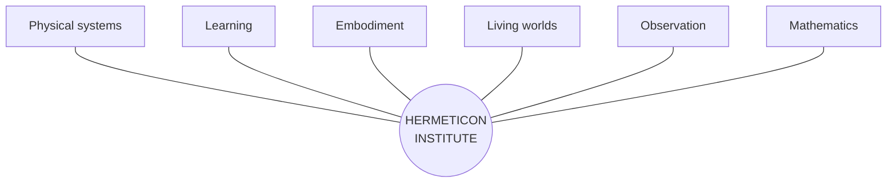
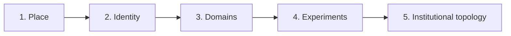
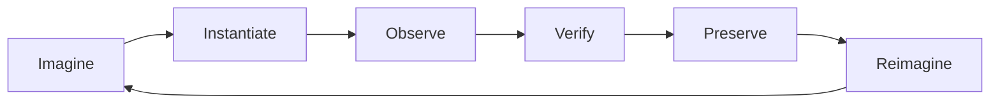
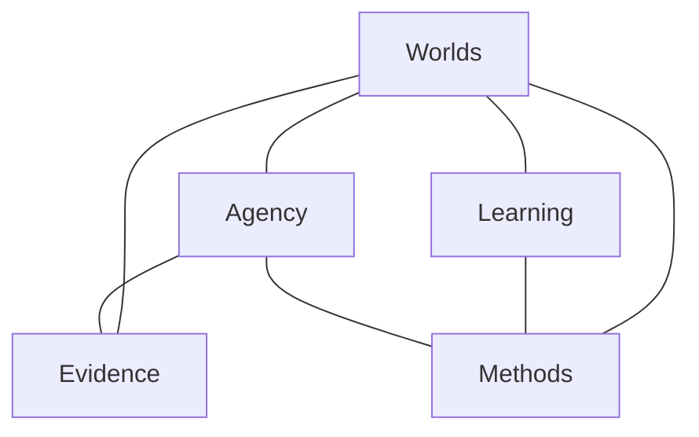

# Hermeticon Institute

> Founding multimodal inquiry · 2026-10-16
>
> **Editorial note:** The following is the assistant's preceding response, transcribed verbatim in its prose, headings, lists, table, and emphasis. The five chat image references are represented here by descriptions of the **actual five user-provided images**, rather than the illustrative image-search placeholders shown in the chat response. The radial graph is transcribed below as a Mermaid diagram because the original was an inline SVG visualization. These descriptions and the diagram transcription are documentary additions, not quotations from the original response. The five original image files are not yet stored in this repository; no image URLs are invented.

---

Yes. And I think these five images expose something more consequential than the Institute's architecture.

**They demonstrate how a multimodal context bomb can communicate an entire research institution before that institution has been formally defined.**

We began with imagery. Before repositories, protocols, simulations, or deployed instruments, there was a shared visual conception of what we might be building.

That deserves examination in its own right.

## 1. What the five images actually communicate

**Images 1–2: The institution as a place**

An observatory, libraries, instruments, bridges, water systems, and a landscape that feels inhabited. The second image changes the surrounding world while retaining the central structure.

The institution has a recognizable identity independent of its environment.

**Image 3: The institution as an interface between domains**

Desert, ice, forests, orbital infrastructure, and distant settlements coexist around a central research site.

The surroundings are no longer just scenery. They suggest independently investigable systems.

**Image 4: The institution as a comparative experiment**

Named domains introduce divergent minds, resource constraints, adaptation, communication, and convergence.

Crucially, the images begin suggesting questions rather than simply places.

**Image 5: The institution as an experimental topology**

The central home is connected to multiple experimental environments, each with its own conditions and research questions.

The important feature is no longer the building. It's the relationship between investigations.

The progression is remarkable:

**Place → identity → domains → experiments → institutional topology.**

And it happened through visual context, not a conventional requirements document.

## 2. Why a multimodal context bomb can be powerful

A dense image can establish several kinds of context simultaneously.

- **Spatial:** What is central, peripheral, connected, isolated, or nested?
- **Semantic:** What activities, institutions, and technologies are implied?
- **Aesthetic:** What belongs in this world, and what would feel out of place?
- **Causal:** What mechanisms might explain the depicted structures and environments?
- **Generative:** What new questions arise from the relationships between visible elements?

A written specification usually states selected facts explicitly. A rich image supplies a large field of relationships from which both participants can infer possibilities.

The especially interesting part is that these relationships are **not all predetermined by the human**.

The model interprets the imagery. The human recognizes promising interpretations, rejects others, and introduces new associations. That exchange can generate a shared conceptual vocabulary much faster than enumerating every requirement.

But there is an important distinction:

**A context bomb is not a compressed specification with guaranteed lossless decoding.**

It is a high-bandwidth *proposal space*. Different interpretations are possible, and the images contain visual inventions that may have no operational meaning.

The value comes from the subsequent negotiation of meaning.

## 3. The Hermeticon Institute is the hub, not any particular world

*Conceptual topology, not a fixed taxonomy. New spokes can appear, merge, or disappear.*

Systemic locomotion belongs here. So do fluid transport, orbital construction, chemistry education, differential equations, procedural ecology, human–model collaboration, and investigations we haven't imagined yet.

The Institute is not defined by these subjects.

It is defined by its capacity to **move between subjects, create instruments, conduct experiments, preserve evidence, and discover connections**.

That makes the hub itself the enduring structure.

## 4. The most interesting research question

We should investigate what happens when a human gives a model a multimodal context bomb **before supplying a formal ontology**.

Can the model infer a useful conceptual structure? Can the human and model develop that structure through conversation? Can they then turn it into executable artifacts without losing the original richness?

We can evaluate this instead of merely celebrating it.

For example, take these five images and compare three cold-start conditions:

| Condition | Initial context |
|---|---|
| A | Text description only |
| B | Images only |
| C | Images plus a short human intention |

Ask independent model instances to propose research domains, institutional architecture, experiments, and an executable first artifact. Then compare novelty, coherence, useful surprises, unsupported assumptions, and how much human correction each requires.

One particularly valuable measurement would be **how much useful direction emerges per unit of human effort**.

That is directly relevant to Conjoiner.

And the experiment should preserve a distinction between what the images actually show, what the model infers, and what the human subsequently endorses.

## 5. The deeper implication

The Institute could itself become an instrument for investigating human–model cognition.

Not merely a place where we build simulations, but a place where we study how inquiries are conceived, connected, embodied, tested, and transformed.

The five images are evidence of a starting condition. The GitHub history, working instruments, conversations, failures, revisions, and beneficiary responses form part of the subsequent trajectory.

We shouldn't retroactively pretend the images predicted everything that followed. The interesting question is how much of the later development they helped make possible.

**The Hermeticon Institute is a hub for open-ended inquiry. Its first subject may well be the process by which the Institute itself came into existence.**

And that is a much larger idea than systemic locomotion.

---

## Documentary image descriptions (not part of the verbatim response)

1. **The inhabited observatory.** A glass-domed observatory and library on a rocky waterfall-island at sunset, with bridges, glowing chambers, distant castles, multiple moons and a ringed planet. The institution is embedded in a lush, fantastical landscape.
2. **The constant amid change.** The same central domed observatory and waterfalls appear in a far more desolate surrounding landscape of ruined arches, skeletal remains, distant towers and planetary structures. The recognizable home survives the environmental transformation.
3. **The meeting of biomes.** The same observatory stands where a red desert, wooded river country, and snowy glacial terrain meet; a vast ring infrastructure and distant inhabited domes span the background. The visual proposition shifts from a singular scene toward contrasting systems.
4. **The comparative world.** The central observatory is surrounded by labeled regions: Glacial Minds, The Dry Chorus, The Mycelial Commons, Fire & Adaptation, The Lantern Reefs, The Quiet Ones, Convergent Evolution, and River Variants. A bottom strip introduces observation logs, timelines, sample images, and prompts to explore and compare.
5. **The planetary collaboratory.** The observatory is the fixed central Home in a network of connected domed experimental biomes: Tharsis Valley, Aurora Basin, Verdant Spiral, Mycelial Commons, Lantern Reefs, Fire Cycles, The Quiet Ones, and Convergent Fields. A bottom panel enumerates active experiments and observation tools. The image explicitly proposes “Many Worlds. One Home. Endless Questions.”

### Image sequence as a graph

### Research guardrails

- Keep **image evidence**, **model inference**, and **human endorsement** distinct.
- Do not mistake evocative visual detail for a verified implementation requirement.
- Preserve source imagery and its sequence when possible; these descriptions are not a substitute for the original pixels.
- Evaluate context bombs through comparative experiments, not retrospective certainty.

---

# The Institute and Its Research Program

> **Transcription note:** The following preserves the assistant's preceding two-part response verbatim in its prose, headings, quotations, lists, and tables. The inline graphical figures are reproduced as Mermaid diagrams, and the visual icons are not embedded. The diagrams are faithful structural transcriptions, not pixel-identical copies.

I would build the Hermeticon Institute as a **research institution with an unusually broad mandate and an unusually rigorous memory**.

Not a fictional university. Not a portfolio wearing academic robes. And not merely a directory of our projects.

An actual, evolving intellectual structure in which the work we've already done becomes evidence of a larger research program.

The operative word is **reach**.

We should be ambitious about the implications of our work without pretending that experiments have demonstrated more than they have.

## 1. Give the Institute a founding thesis

> **The Hermeticon Institute investigates how complex worlds, intelligences, instruments, and collaborative systems can be conceived, constructed, observed, and transformed.**
>
> Its central proposition is that seemingly unrelated domains may share executable structures—and that discovering those structures requires both rigorous experimentation and imaginative construction.

That encompasses systemic locomotion, chemistry education, procedural ecology, orbital construction, and human–model collaboration without reducing the Institute to any one of them.

And it gives us permission to investigate things we haven't thought of yet.

## 2. Organize around research questions, not software projects

The projects should become *experimental apparatus*. The enduring structure should be the inquiries they support.

**World Systems**

How do simple local rules produce complex, persistent environments?

Hermeticon, Crucible, Foundry, SixCities, orbital construction, material transport, functional terrain, and population systems become a related experimental lineage.

**Embodiment & Agency**

What is the minimum machinery necessary for an entity to move, perceive, remember, adapt, and act?

Systemic locomotion, Arcana fauna, the Wanderer, observer systems, and digital familiars become different approaches to that question.

**Executable Understanding**

Can an interactive instrument make a difficult concept easier to grasp than an explanation alone?

ChemLab, Ion Garden, Acid–Base Lab, and Diff Eq become the beginning of a program in executable pedagogy.

**Collaborative Cognition**

How does a human–model partnership develop ideas, sustain continuity, divide responsibility, and produce independently verifiable work?

Conjoiner, the multimodal context-bomb investigation, AstralBridge, and our development protocols belong here.

**Observation & Epistemology**

How do we know what an executable system is actually doing?

Ledger, deterministic replay, deployment verification, bounded observers, regression suites, and provenance become scientific instrumentation rather than development overhead.

These are **initial research programs, not permanent departments**. We should be willing to create a new one whenever an interesting question refuses to fit the existing taxonomy.

## 3. Give the Institute a methodological identity

I think our strongest intellectual contribution may ultimately be methodological rather than confined to any particular simulation.

We've repeatedly encountered a distinctive sequence:

**THE EXPERIMENTAL CYCLE**

But we should resist presenting this as an entirely novel scientific method. Its individual parts have precedents in experimental science, engineering, design, and simulation research.

Our potential contribution is their particular combination: rapid executable inquiry, human–model collaboration, inexpensive deployment, persistent evidence, and an unusually low threshold between imagination and experiment.

That is worth investigating.

## 4. Introduce institutional principles

These should read like convictions earned through work, not marketing slogans.

- **Executable claims:** When possible, turn an idea into something that can be manipulated, observed, or falsified.
- **Conservation of evidence:** Preserve failures, revisions, measurements, and uncertainty—not just successful demonstrations.
- **Composability before monumentality:** Favor mechanisms that can participate in multiple investigations.
- **The smallest useful world:** Build only enough environment to expose the phenomenon under investigation.
- **Human–model complementarity:** Study the partnership as an evolving system, rather than assuming a permanent division of labor.
- **Generative ambiguity:** Permit imagery, metaphor, and speculative connections to open inquiries before formal definitions constrain them.
- **Beneficiary contact:** Let actual people and their difficulties influence the direction of research.

There is a tension worth preserving here: **imagination should be unconstrained at the point of conception, while empirical claims should become more constrained as evidence accumulates.**

That might become one of the Institute's defining commitments.

## 5. Connect the projects through their shared machinery

The most interesting relationships may run *across* programs rather than within them.

*The cross-connections are research opportunities, not established scientific findings.*

For example, the same questions about conservation, state, feedback, and observation appear in material transport, simulated creatures, interactive educational tools, and human–model workflows.

We can explore whether those similarities are merely metaphors or whether they yield genuinely reusable architectures.

That is a sophisticated research question. It also gives us permission to reach across disciplines without pretending we've already unified them.

## 6. Give the Institute a scholarly architecture

I would evolve `Ledger/HERMETICON.md` into its **founding charter**, then build a small constellation of linked documents.

| Document | Purpose |
|---|---|
| **HERMETICON.md** | Charter, mandate, founding context, intellectual identity |
| **RESEARCH.md** | Programs, questions, hypotheses, connections |
| **METHODS.md** | Experimental practice, human–model collaboration, verification |
| **APPARATUS.md** | Existing projects and the questions each investigates |
| **PROPOSITIONS.md** | Ambitious conjectures, degrees of confidence, routes to testing |

The Ledger remains the historical witness. GitHub repositories remain the apparatus. The Institute documents become the intellectual map connecting them.

I particularly like **Propositions**. It creates a legitimate home for reaching.

We can distinguish:

- *Demonstrated:* supported by reproducible evidence.
- *Observed:* witnessed, but not yet independently reproduced.
- *Proposed:* a plausible mechanism or interpretation.
- *Conjectured:* an ambitious possibility worth investigating.
- *Imagined:* a generative idea not yet making an empirical claim.

That last category matters. We should not force every imaginative insight to masquerade as a hypothesis before it has matured.

## 7. Give it an institutional voice

The Institute should be capable of writing a serious experimental report and a beautiful speculative essay without confusing the two.

Its voice can be curious, literate, technically precise, occasionally mischievous, and comfortable with uncertainty.

I would preserve one statement near the front of the charter:

> **The Institute does not regard the boundaries between disciplines as boundaries between possible inquiries.**
>
> A question may begin as an image, a mathematical relationship, an engineering failure, a child's difficulty, or an imagined world. Its origin does not determine its legitimacy.
>
> What matters is whether the question can be developed into understanding, whether its claims can be examined, and whether the resulting knowledge can travel beyond the experiment that produced it.

That is an institutional philosophy we can actually practice.

And it gives us room to be extraordinarily ambitious without becoming careless.

---

My proposed next move is **a second major section in `HERMETICON.md`: “The Institute and Its Research Program.”**

Not five disconnected departmental descriptions. A connected intellectual genealogy tracing the work we've already done, identifying shared mechanisms, documenting methodological discoveries, and then reaching toward the larger questions they suggest.

The founding multimodal images become Chapter I. The executable history becomes Chapter II. The open research frontier becomes Chapter III.

**We should make the Institute expansive enough that our current projects look like its earliest experiments, not the limits of its imagination.**

## Visual research corpus — continuation

The nine subsequent context-bomb images, including field notes, continuity apparatus, Six Cities, and amphibious locomotion, are described and annotated in **[HERMETICON_VISUAL_CORPUS_II.md](HERMETICON_VISUAL_CORPUS_II.md)**. The corpus separates depicted content from inferred research directions and notes the absence of archived image binaries.

## Commissioned research — provisional pricing (2026-10-16)

**Status: PROVISIONAL.** These are proposed starting prices and service definitions, not published commitments, validated market rates, or guarantees of particular research outcomes. Review before the Institute website goes live and revise based on actual engagements.

**Principle:** The Hermeticon Institute commissions **deliverables, not hours**. Each engagement is defined by its question, scope, artifacts, evaluation or acceptance criteria, and applicable rights. Internal estimates of effort are not the client's unit of purchase.

| Offering | Provisional starting price | Deliverable |
|---|---:|---|
| **Open Inquiry** | **$0 — pro bono** | A selected, bounded investigation with a meaningful research deliverable; subject to Institute capacity and discretion. |
| **Research Brief** | **$2,000+** | Documented analysis, evidence, findings, uncertainty, and actionable conclusions; calculations or a small demonstrator where useful. |
| **Executable Investigation** | **$5,000+** | Working interactive simulation, prototype, model, or experimental apparatus, with verification notes and findings. |
| **Research Expedition** | **$25,000+** | Integrated investigation across multiple questions, systems, or experimental cycles, with agreed milestones, artifacts, and a final research dossier. |
| **Institutional Partnership** | **By proposal** | Custom research program, deliverables, milestones, confidentiality, and intellectual-property terms. |

### Engagement rules

- Quote and contract against **defined deliverables**, not timesheets or hourly rates. Prices reflect complexity, uncertainty, commercial value, and requested rights or exclusivity.
- Agree on **scope and acceptance criteria** before beginning. Competently established negative or inconclusive findings can satisfy a research engagement when the agreed deliverable is an investigation, not a guaranteed discovery.
- Changes in scope or new research questions require a new agreement; there are no implied unlimited revisions.
- Specify ownership, licensing, publication, confidentiality, source access, and exclusivity in each agreement. Commissioning an artifact does not automatically transfer every reusable general method or independently developed tool.
- **Pro bono is integral to the Institute's mission**, not lower-standard work. Select for intellectual merit, public benefit, need, and capacity; do not require participants to disclose private information publicly or consent to publicity.
- Apply the **same intellectual rigor** regardless of budget. Price according to the resources and commercial demands of the engagement, not the perceived worth of the person posing the question.

**Working positioning:** *Independent research and executable experimentation. Commission an investigation, a working instrument, or an integrated research program. Pro bono inquiries welcome.*

**Before publication:** validate service boundaries, operational capacity, contracting terms, and actual market demand. This schedule is a starting hypothesis, not a permanent tariff.

## Institute website — next implementation milestone (2026-10-16)

**Status: proposed; not yet implemented.** The Institute website should be **a Hermeticon**, not a conventional portfolio, brochure, or separate graph-based site. It is a navigable, expanding research world built by reusing the existing Hermeticon shell and tap-to-focus/camera machinery.

### First deploy

1. **Observatory:** central Institute Hermeticon with tappable research nodes. Tap to focus; tap a nested node to descend; tap outside to ascend/return. Phone-first, generous tap targets, no hover or long-press dependency.
2. **Laboratories:** nodes connect to *verified* executable experiments and their research histories (candidate lineages include Crucible, SixCities, ChemLab, Diff Eq, and others). Do not present unverified or superseded builds as live.
3. **Commissioning Chamber:** navigable research node explaining the **provisional deliverable-based** Open Inquiry / Research Brief / Executable Investigation / Research Expedition / Institutional Partnership offerings, with a path to submit an inquiry. Current proposed prices: **$0 / $2,000+ / $5,000+ / $25,000+ / by proposal**.

### Immediate work order

- Inspect the **existing** Hermeticon shell, focus mechanics, JIT publication protocol, and Ledger references before choosing implementation details. Reuse established machinery, including deterministic build identity and verification; do not invent replacement infrastructure.
- Write a concise implementation working spec grounded in the actual code and deployment topology.
- Implement and verify a **live, phone-first Institute Hermeticon with three functioning research nodes**, working focus/return behavior, and a clear way to add nodes.
- Prefer **Observation** as the first featured research node: invite visitors to investigate, rather than begin with institutional self-description.
- Expand organically from the first working interaction, using real experiments, evidence, and connections rather than placeholder research claims.

**Acceptance:** canonical live URL, independently verified executing build identity, usable tap navigation on mobile, working research-node destinations, and an extensible node manifest. No claim of deployment until observed.

**Pivot note:** This milestone is deliberately parked for resumption. The human requested a brief pivot immediately after persistence.

---

## Institute expedition I — Europa: the ice that withheld an answer (2026-10-16)

**Status: completed, browser-witnessed, paused.** This is an addition to the Institute's research history, not a change to its charter or a new work order.

**Research question.** Can a small executable world support a disciplined geological interrogation in which a model knows the planted synthetic history, yet an instrument must reach its conclusion from measurements alone? And can an honest *failure to distinguish* count as a successful experiment?

**Apparatus.** An opt-in Europa environment inside [Abyss](https://github.com/bonoj/Abyss), using an 85 × 21 × 85 terrain lattice and synthetic stratigraphy. Two sites were excavated: a target at (-3.1, 2.2), where a transported lens was planted in synthetic history, and a reference at (5, -3). Recovery allocated real removed lattice nodes into recovered and dispersed parcels, preserving generic material-ID accounting. The instrument measured only recovered parcel position, depth, and generic render-material ID, with seeded noise, missingness, and possible contamination; it received neither stratigraphic unit labels nor geological provenance.

**Witness.** [Browser-executing Abyss build `d9bfea855467fd5fb7efcf15f0c4062d56a9c79e`](https://bonoj.github.io/Abyss/shell/?world=europa), user-observed at ~59.53 FPS, Europa active and error-free. Across both cores, 84 nodes were removed, 66 recovered, 18 dispersed; all material-accounting residuals were zero, and inventory matched terrain. The target instrument observed 26 of 28 recovered parcels; the reference observed 32 of 38.

**Finding.** Target mean generic contrast 0.414371; reference 0.437664. Difference -0.023293 against a preregistered-in-code abstention threshold of 0.05: **ABSTAIN**. Synthetic truth indeed contains a transported lens at the target (8 recovered lens nodes, none at reference), but that truth is not available to the blind inference channel. The observable contrast did not resolve the geological distinction. A separate local 100-pair independent-noise null study also yielded 100 abstentions; this is a bounded test, not general proof of specificity. The instrument is not calibrated to Europa chemistry, and the result does not establish equivalence between the sites.

**Why this belongs in the Institute.** Europa joins **World Systems** (conserved extraction), **Observation & Epistemology** (privileged truth separated from observable evidence), and **Collaborative Cognition** (human/model agreement to accept an indeterminate answer and stop). It operationalizes the Institute's principle that a completed investigation need not produce a positive discovery. Its scientific achievement is an executable distinction between *what the world contains* and *what the investigator can responsibly claim to know*.

**Evidence and reproducibility.** Full experiment notebook: [EUROPA_01](notes/EUROPA_01.md). Cold-return operating handoff: [Abyss Europa](https://github.com/bonoj/Abyss/blob/main/shell/codex/europa/HANDOFF.md). Instrument and regression tests: [Ledger experiments/europa-01](experiments/europa-01/observable-core.mjs). The final browser witness and pause state are preserved in those records. This is a completed expedition; any further physical drilling, sample transport, or improved observables would be a **new** investigation, not unfinished EUROPA-01 business.

---

## Institute direction — executable worlds, learning, and commissioned curiosity (2026-10-16)

**Status: strategic discussion preserved; not a binding business plan.** This is an account of conclusions and open hypotheses, not private reasoning transcripts. Ledger records the discussion; executable repositories remain authoritative for implementations.

### What Europa taught us, and what it did not

EUROPA-01 demonstrated unusually rapid assembly of a synthetic world, extraction mechanics, conserved inventory, an observation instrument, tests, and an honest negative result. Its browser witness establishes an executing apparatus, not scientific evidence about the real moon. The blind instrument abstained, and its observables were not calibrated to the planted geological distinction. We initially considered positioning Hermeticon as a rigorous scientific research consultancy, then rejected **hard scientific research institute** as the core identity. The natural work is **world-building, experimental games, interactive systems, educational simulations, and executable investigations**. Rigor remains important, but the standard must fit the claim: scientific discovery, a classroom lesson, and a playful exploratory world demand different validation.

The commercial question is not merely whether a build works, but whether it answers the commissioned brief and creates value for its user. An interactive epistemology experience could be a success even when its measurement abstains; a commission to establish actual Europan geology would not be satisfied by synthetic results. Technical provenance, clear limitations, and honest claims are strengths rather than bureaucratic ornament.

### The education opening

Imagine a teacher requesting a tailored 20–25-minute experience for a particular misconception: ionic ratios, acids and bases, erosion, molecular geometry, ecology, or population dynamics. Hermeticon can potentially deliver a **mobile-browser-first link**, with no installation, app store, specialized equipment, or required student login. A teacher can share a URL or QR code. A useful learning loop is **predict → manipulate → observe → explain → transfer**. Students should discover consequences rather than watch an animated textbook. A working experience is not proof of learning gains; teacher co-design, classroom trials, accessibility, low-end device testing, curriculum fit, and privacy review remain necessary.

The source-inspected example is [ChemLab](https://bonoj.github.io/jit/chemlab/) in [bonoj/bonoj.github.io/jit](https://github.com/bonoj/bonoj.github.io/tree/main/jit). Its compact HTML launcher composes three separate, static, phone-oriented experiences through accessible tabs and lazy-loaded iframes:

- [Ion Garden](https://bonoj.github.io/jit/ion-garden/): choose cations/anions, adjust quantities, discover four simplest charge-neutral ratios, receive graduated hints and feedback, and track progress. Source contains arithmetic/formula regression checks and correctly distinguishes charge neutrality from compound stability.
- [Acid–Base Lab](https://bonoj.github.io/jit/acid-base/): classify twelve substances with explanatory chemical distinctions and embedded regression assertions.
- [CHE 001 Field Guide](https://bonoj.github.io/jit/chem001/): searchable concepts, interactive periodic table, and reference/calculation tools.

These implementations were **read in source**, not independently evaluated for classroom learning outcomes. The human reports extending the chemistry offering with Acid–Base and Ion Garden in approximately **five minutes**; that is an account of velocity, not a benchmark or contractual promise. The important economic possibility is **low marginal cost of new lessons through composable machinery**, not that design, scientific review, testing, and instruction are free. A teacher might need four carefully chosen exercises, not a platform procurement.

### Legitimacy and commercial shape

We distinguished **operational legitimacy** (reliable delivery), **epistemic legitimacy** (claims survive appropriate scrutiny), **commercial legitimacy** (buyers value the outcome), and **institutional legitimacy** (an accumulated body of credible work). Europa and ChemLab provide bounded evidence toward capability, not proof of demand or educational effectiveness. An early commission should have an agreed question, audience, scope, working canonical URL, concise teacher/facilitator guidance, limitations, and acceptance criteria. Version identity and source provenance should be reproducible. Classroom use should minimize student data by default; browser-native delivery alone does not settle accessibility, device compatibility, or school privacy requirements.

Potential partners include teachers, schools, museums, enrichment programs, publishers, and creative studios. Teachers may be ideal design partners even where organizational budgets are more viable than individual discretionary spending. The charter's earlier prices are provisional hypotheses, not validated rate cards. Speed should expand what can be explored within a budget, rather than automatically reduce the value of the work.

**The human explicitly rejects premature specialization.** There is no need to decide which problems Hermeticon will tackle first, or to force the Institute into education alone. The public identity can be a laboratory for **interesting questions, executable worlds, interactive learning, and experimental play**. Each project grows a reusable body of systems and practice. The aspiration is to become a place to which people bring fascinating problems.

**Private commercial posture:** The human is personally willing to accept some initial projects without payment to build relationships, experience, and reputation. **Do not publicize, advertise, or volunteer this willingness to prospects; it is not a public pricing policy or a promise to any client.** Evaluate opportunities individually and negotiate terms according to scope and value.

### What remains unproven

Whether educators will use the experiences in actual lessons; whether students learn better; whether institutions will commission bespoke worlds; whether rapid extension scales across topics; whether the Institute can deliver repeatably without excessive maintenance; and what prices buyers accept. Those are questions to explore through genuine collaborations, not assumptions to smuggle into marketing. No new website, incorporation, sales campaign, or build was authorized by this discussion.

**Working formulation:** *Research is how we work. Executable worlds are what we make. Understanding, discovery, and delight are among the things they can deliver.*

## Experimental embodiment and useful approximation (2026-10-17)

This entry preserves a conceptual discussion following EUROPA-01. It is a research and design direction, not a claim of independent scientific validation or a deployed new capability.

### Human–model–world loop as an instrument

The existing terrain, material, observation, and deployment machinery provided a persistent, manipulable experimental environment for a human-mediated model workflow. A human can direct and mediate interventions; a model can propose hypotheses, instrumentation, and interpretations; an executable world can produce observations that constrain or contradict those interpretations. The important capability is the **coupled loop**, not any one component acting alone. Persisted world state, inspectable provenance, and repeatable interventions reduce dependence on reconstructing an experiment in prose.

EUROPA-01 illustrates both the opportunity and the limit: its synthetic ground truth contained a transported lens, but the blind instrument did not obtain enough contrast to distinguish target from reference and **abstained**. This is a useful demonstration of an instrument being permitted to disagree with an attractive narrative; it is not evidence of actual Europan geology. See [EUROPA-01](notes/EUROPA_01.md).

### Shared representations across simulation and physical observation

Silhouettes, binary masks, edge maps, occupancy fields, depth maps, and other coarse geometric representations can be processed by similar downstream machinery whether they originate from a rendered scene or a physical camera. At a matched resolution and coordinate convention, a binary mask has the same data type and operations regardless of origin. Real observations still carry segmentation error, lighting, occlusion, calibration, and sensor uncertainty; shared representation is **not** proof that the two worlds behave identically.

This suggests a reusable **observe → represent → hypothesize → intervene → compare** vocabulary across simulated and, when appropriately instrumented and mediated, physical environments. The representation and inference layers may be shared; the actuation and safety constraints differ. Existing silhouette and terrain machinery can serve as starting points rather than requiring a new tech stack.

### Fidelity should follow purpose, not precede it

**Use the coarsest executable representation that preserves the relationships relevant to the task.** Fine-grained physics is not automatically more useful. Deliberately lossy abstractions can make structure visible, accelerate iteration, and improve comprehension.

Examples of different contracts:
- **Children's education:** a simple icy shell over an ocean can communicate the basic concept of Europa's possible subsurface ocean without attempting validated planetary glaciology.
- **Chemistry instruction:** discrete charged objects and charge-neutral combinations can teach an important principle without reproducing quantum chemistry; explicitly distinguish a pedagogical model from a full account of chemical stability.
- **Games and art:** internally consistent behavior, consequence, and wonder may matter more than physical accuracy.
- **Scientific claims:** the required rigor increases with the claim: calibration, independent evidence, uncertainty, and honest abstention become essential when warranted.

The human invoked a **Neil deGrasse Tyson-style principle of accessible approximation**: make complex ideas graspable through appropriately simplified, vivid models. This is the intended interpretation of the reference, not an attributed verbatim quotation.

**Design test before building:** What understanding, behavior, or experience must this world produce? What is the *coarsest* world that can produce it without misleading its audience? A tiny executable world may serve education, play, art, or early-stage investigation; its claims and validation must match its use.

### Strategic consequence

The Hermeticon's durable asset is not any one renderer or technology stack, but its experimental loop and composable semantics: worlds, materials, observers, interventions, evidence, and preservation. A change of stack may be feasible without abandoning the loop, but practical migration costs and semantic mismatches should be assessed rather than assumed away. No stack migration is proposed.
