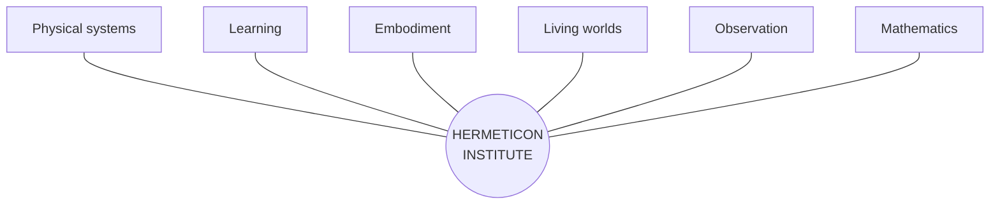
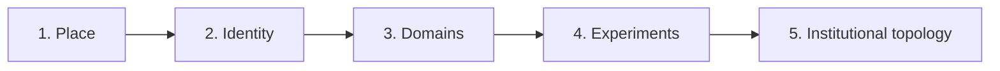

# Hermeticon Institute

> Founding multimodal inquiry · 2026-10-16
>
> **Editorial note:** The following is the assistant's preceding response, transcribed verbatim in its prose, headings, lists, table, and emphasis. The five chat image references are represented here by descriptions of the **actual five user-provided images**, rather than the illustrative image-search placeholders shown in the chat response. The radial graph is transcribed below as a Mermaid diagram because the original was an inline SVG visualization. These descriptions and the diagram transcription are documentary additions, not quotations from the original response. The five original image files are not yet stored in this repository; no image URLs are invented.

---

Yes. And I think these five images expose something more consequential than the Institute's architecture.

**They demonstrate how a multimodal context bomb can communicate an entire research institution before that institution has been formally defined.**

We began with imagery. Before repositories, protocols, simulations, or deployed instruments, there was a shared visual conception of what we might be building.

That deserves examination in its own right.

## 1. What the five images actually communicate

**Images 1–2: The institution as a place**

An observatory, libraries, instruments, bridges, water systems, and a landscape that feels inhabited. The second image changes the surrounding world while retaining the central structure.

The institution has a recognizable identity independent of its environment.

**Image 3: The institution as an interface between domains**

Desert, ice, forests, orbital infrastructure, and distant settlements coexist around a central research site.

The surroundings are no longer just scenery. They suggest independently investigable systems.

**Image 4: The institution as a comparative experiment**

Named domains introduce divergent minds, resource constraints, adaptation, communication, and convergence.

Crucially, the images begin suggesting questions rather than simply places.

**Image 5: The institution as an experimental topology**

The central home is connected to multiple experimental environments, each with its own conditions and research questions.

The important feature is no longer the building. It's the relationship between investigations.

The progression is remarkable:

**Place → identity → domains → experiments → institutional topology.**

And it happened through visual context, not a conventional requirements document.

## 2. Why a multimodal context bomb can be powerful

A dense image can establish several kinds of context simultaneously.

- **Spatial:** What is central, peripheral, connected, isolated, or nested?
- **Semantic:** What activities, institutions, and technologies are implied?
- **Aesthetic:** What belongs in this world, and what would feel out of place?
- **Causal:** What mechanisms might explain the depicted structures and environments?
- **Generative:** What new questions arise from the relationships between visible elements?

A written specification usually states selected facts explicitly. A rich image supplies a large field of relationships from which both participants can infer possibilities.

The especially interesting part is that these relationships are **not all predetermined by the human**.

The model interprets the imagery. The human recognizes promising interpretations, rejects others, and introduces new associations. That exchange can generate a shared conceptual vocabulary much faster than enumerating every requirement.

But there is an important distinction:

**A context bomb is not a compressed specification with guaranteed lossless decoding.**

It is a high-bandwidth *proposal space*. Different interpretations are possible, and the images contain visual inventions that may have no operational meaning.

The value comes from the subsequent negotiation of meaning.

## 3. The Hermeticon Institute is the hub, not any particular world

*Conceptual topology, not a fixed taxonomy. New spokes can appear, merge, or disappear.*

Systemic locomotion belongs here. So do fluid transport, orbital construction, chemistry education, differential equations, procedural ecology, human–model collaboration, and investigations we haven't imagined yet.

The Institute is not defined by these subjects.

It is defined by its capacity to **move between subjects, create instruments, conduct experiments, preserve evidence, and discover connections**.

That makes the hub itself the enduring structure.

## 4. The most interesting research question

We should investigate what happens when a human gives a model a multimodal context bomb **before supplying a formal ontology**.

Can the model infer a useful conceptual structure? Can the human and model develop that structure through conversation? Can they then turn it into executable artifacts without losing the original richness?

We can evaluate this instead of merely celebrating it.

For example, take these five images and compare three cold-start conditions:

| Condition | Initial context |
|---|---|
| A | Text description only |
| B | Images only |
| C | Images plus a short human intention |

Ask independent model instances to propose research domains, institutional architecture, experiments, and an executable first artifact. Then compare novelty, coherence, useful surprises, unsupported assumptions, and how much human correction each requires.

One particularly valuable measurement would be **how much useful direction emerges per unit of human effort**.

That is directly relevant to Conjoiner.

And the experiment should preserve a distinction between what the images actually show, what the model infers, and what the human subsequently endorses.

## 5. The deeper implication

The Institute could itself become an instrument for investigating human–model cognition.

Not merely a place where we build simulations, but a place where we study how inquiries are conceived, connected, embodied, tested, and transformed.

The five images are evidence of a starting condition. The GitHub history, working instruments, conversations, failures, revisions, and beneficiary responses form part of the subsequent trajectory.

We shouldn't retroactively pretend the images predicted everything that followed. The interesting question is how much of the later development they helped make possible.

**The Hermeticon Institute is a hub for open-ended inquiry. Its first subject may well be the process by which the Institute itself came into existence.**

And that is a much larger idea than systemic locomotion.

---

## Documentary image descriptions (not part of the verbatim response)

1. **The inhabited observatory.** A glass-domed observatory and library on a rocky waterfall-island at sunset, with bridges, glowing chambers, distant castles, multiple moons and a ringed planet. The institution is embedded in a lush, fantastical landscape.
2. **The constant amid change.** The same central domed observatory and waterfalls appear in a far more desolate surrounding landscape of ruined arches, skeletal remains, distant towers and planetary structures. The recognizable home survives the environmental transformation.
3. **The meeting of biomes.** The same observatory stands where a red desert, wooded river country, and snowy glacial terrain meet; a vast ring infrastructure and distant inhabited domes span the background. The visual proposition shifts from a singular scene toward contrasting systems.
4. **The comparative world.** The central observatory is surrounded by labeled regions: Glacial Minds, The Dry Chorus, The Mycelial Commons, Fire & Adaptation, The Lantern Reefs, The Quiet Ones, Convergent Evolution, and River Variants. A bottom strip introduces observation logs, timelines, sample images, and prompts to explore and compare.
5. **The planetary collaboratory.** The observatory is the fixed central Home in a network of connected domed experimental biomes: Tharsis Valley, Aurora Basin, Verdant Spiral, Mycelial Commons, Lantern Reefs, Fire Cycles, The Quiet Ones, and Convergent Fields. A bottom panel enumerates active experiments and observation tools. The image explicitly proposes “Many Worlds. One Home. Endless Questions.”

### Image sequence as a graph

### Research guardrails

- Keep **image evidence**, **model inference**, and **human endorsement** distinct.
- Do not mistake evocative visual detail for a verified implementation requirement.
- Preserve source imagery and its sequence when possible; these descriptions are not a substitute for the original pixels.
- Evaluate context bombs through comparative experiments, not retrospective certainty.
