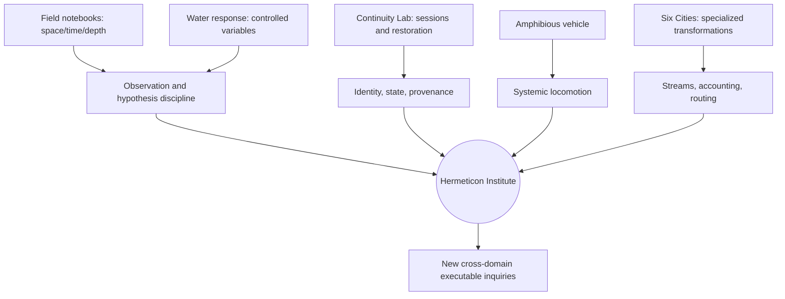

# Hermeticon Institute — Visual Research Corpus II

**Date:** 2026-10-16  
**Source:** Nine images supplied by the human in the Institute conversation, following the original five-image founding sequence.  
**Status:** Visual primary-source descriptions and manual transcription. **The original image pixels are attached to the conversation, not yet deposited as binary assets in Ledger.**  
**Reading rule:** These are *depicted* experiments, invented places, illustrative interfaces, and proposed apparatus. No pictured measurements, operational states, or results should be treated as independently verified. Small stylized text may be uncertain; descriptions privilege reliably legible text and explicitly distinguish interpretation.

## 1. Field Notes — geography and the first expedition

**Composition.** A warm, amber-lit observatory/library with three immense arched windows, flowered columns, celestial banners (sun and crescent), a telescope, armillary globe, candles, books, a sleeping striped cat, and a woman recording observations in a notebook. Beyond the arches: a smoking volcano, a fantastical castle across stepped waterfalls, sunset, and a ringed planet. On the desk lies a detailed three-dimensional miniature landscape of forests, waterways, bridges, settlements, mountains, and waterfalls. The investigator is simultaneously *in* the world and looking at a scale model of it.

**Visible field checklist:** “Map visible features”; “Compare with prior notes”; “Track river system”; “Check for anomalies”; “Investigate Cinnabar Crossings”; “Determine source of Northfall”; “Look for evidence of older civilization”; “Collect samples (when possible).” Marginal maxim: **“A map is a conversation with a place.”**

**Named annotation cards and questions:**
- **Ashen Spine:** active plume (larger); lava flows (new?); ash fields expanding?; unusual crystal deposits?; approach route?
- **Northfall:** multiple cascades; massive ruins; pre-Current structures?; unnatural geometry?; source of river system?; worth extended survey.
- **Three Sisters:** alignment at solstice?; observatory remains?; same construction style?; volcanic (dormant)?; matching star chart?
- **Verdant Reach:** fertile valley; settlements (clustered); trade road (active); unusual forest (luminescent?); reports of singing trees?
- **Cinnabar Crossings:** three bridges (confirmed); tollhouses/customs; heavy traffic (river + land); carvings match earlier symbols; local name origin?; who controls the crossings?
- **Eastern Basin:** seasonal lake (high); terraced formations; ruins at lower level?; different ecosystem; possible second outlet?

**Open fieldbooks:** Ashen Spine (west face), Cinnabar Crossings (city & bridges), Northfall (main cascade), Three Sisters (from east), each with sketches and provisional claims rather than finished conclusions. The book stack names **Curiosities Across Worlds; Rivers & Watersheds; Volcanoes & Geology; Settlements & Cultures; Skies & Phenomena; The Long View.** Another stack names **Worlds Together; The Continuum Atlas; Portals & Places; On Belonging.** Right-hand “Questions for Next Expedition” include following Northfall to its source, crossing at Cinnabar, surveying Three Sisters, investigating Eastern Basin, looking for older ruins, collecting geological samples, recording local names and accounts, mapping a river delta, and watching for consistent symbols. Closing sentiment: **“Same stars. Further questions.”**

**Research implications:** situated observation, spatial reference frames, cartographic uncertainty, hypothesis-led exploration, provenance of local accounts, multiscale representation, and the difference between an attractive world model and a surveyable one.

## 2. Field Notes (Time) — celestial cycles and recurring signals

**Composition.** The same researcher and cat, now in a richly instrumented night observatory. A luminous vertical timeline of a celestial event stands at center, with orbital loops and day labels **Day 0, 4, 8, 12, 16, 20, 24, 28**. Outside, a brilliant comet crosses a planetary sky above a castle and waterfalls. Telescopes, an orrery, hanging mechanisms, candles, hourglass, spectra, and orbital diagrams establish a temporal investigation rather than a spatial survey.

**Visible field checklist:** track orbital motion; compare with prior cycles; record light spectra; note anomalies; identify correlations (surface/below); monitor current event; capture longer exposure; check for non-astronomical lights; model potential cause; prepare summary for sister(s); “What happens next?”

**Banners:** **“PATTERNS PERSIST / MEANING EMERGES”** and **“TIME CONNECTS WHAT SPACE DIVIDES.”** Central motto: **“SAME SKY / DIFFERENT STORIES.”**

**Event panel:** **Current Event: Comet Aurelian**; first observed Day 0; current position Day 28; closest approach approximately six days (as depicted); apparent magnitude increasing; spectral profile unusual (see notes); orbital period unknown (long?); possible origin outer system?; anomalous features persist.

**Notebooks and graphs:** “Orbital Resonance (Refined)” shows nested orbital paths, approximate 3:5 resonance (outer:inner), perturbation near an outer region, possible trajectory intersection at a resonance window, and a prompt to revisit with updated mass estimates. “Spectral Evolution (Comet)” shows a day-by-day multicolored spectrum and notes increasing cyan emission (CN?), new sodium line (Day 16), unusual IR feature (Day 20–28), comparison with known comet spectra, and a tentative artificial-signature question explicitly treated as unlikely. “Phase Correlation (Preliminary)” plots lunar phase, tidal model, subterranean signal, and comet brightness; notes a possible 17-minute harmonic, peaks near perigee, an approximately three-minute phase offset versus tidal model, and the need to monitor another cycle. **These are fictional illustrated plots, not measured datasets.**

**Next-cycle questions:** will the 17-minute signal repeat? Is it tied to lunar perigee? Does the comet's path affect it? Any response from below? Atmospheric anomalies? Similar archive patterns? What changes at this phase? Natural resonance? Cause or coincidence? What story is the sky trying to tell?

**Research implications:** longitudinal observation, periodicity, synchronization, aliasing and confounders, cross-domain correlations, speculative mechanisms, and the discipline of repeating a measurement before claiming a causal link.

## 3. Field Notes (Subterranean) — a signal through depth

**Composition.** Same investigator, notebook, cat, candles, and bannered field station, now facing a cavern of stacked illuminated lakes, waterfalls, bridges, vertical shafts, stalactites, and concentric glowing rings. Blue-white luminous structures recur at multiple depths. The image puts a vertical physical world directly beside instruments that attempt to measure its internal regularity.

**Visible field checklist:** track 17 min resonance; map vertical structure; sample multiple depths; compare mineral spectra; check for phase shift; monitor water flow/pressure; determine signal origin; ask natural or artificial?; look for repeating geometry; what lies below the lake?; how deep does this go?; are we inside a larger system?; what will we find next?

**Banners:** **“CURIOSITY DESCENDS FURTHER”**, **“THE DEEPER WE GO / THE MORE IT RHYMES”**, and **“SAME SIGNAL / DIFFERENT DEPTHS.”**

**Instrument panels:** “Vertical Resonance Profile (Live)” depicts a 17 mHz signal and stacked traces labeled from surface through progressively deeper stations (e.g. 250 m, 500 m, 750 m, 1,000 m, 1,250 m, 1,500 m and 2,000 m). “Phase Shift vs. Depth” plots phase against depth, approximately from 0 to 2,000 m, with a query about consistent standing waves and a provisional phase gradient. “Cavern Structure (Composite)” visualizes a vertically repeating chamber/shaft network and distinguishes mapped, inferred, water-channel, resonant-node, vertical-shaft, and unknown regions. **Units and values are part of the visual fiction and are not internally validated; 17 mHz and a 17-minute cycle are not the same frequency.**

**Notebooks:** “Multi-Depth Waveforms (17 mHz)” overlays traces at multiple depths and suggests the signal persists, varies in amplitude, and shifts phase with depth; a standing-wave or layered-resonance explanation is considered. “Possible Origins” groups alternatives: natural/geological (water-column resonance, cavern geometry, tectonic stress cycles, hydrothermal activity); biological/unknown (large-scale organism, colony behavior, bioluminescent signaling); artificial (built structure, power source elsewhere, subset of larger system); and “Other / Not yet conceived.” “Cave Section (Preliminary)” diagrams layered rock, water, mapped/inferred channels, resonant nodes, and vertical shafts; questions whether repeating chamber geometry is natural or designed. “Questions for Next Descent” includes sampling at 2,000 m, checking phase trends and lateral variation, mapping shafts, testing for artificial materials, thermal anomalies, additional resonant layers, connected caverns, local versus larger phenomenon, and identifying what the signal is doing.

**Research implications:** inference from sparse sensors, tomography, phase propagation, multiscale resonance, hypothesis competition, measurement design, and the danger of turning visually compelling patterns into unwarranted causal stories.

## 4. Continuity Lab — persistent worlds and projects

**Composition.** A brass-framed dark software dashboard headed **CONTINUITY LAB — PERSISTENT WORLDS. SHARED DISCOVERY.** Top navigation: **EXPLORE | BUILD | READ | RETURN**. Date shown: **Tue Sep 16 2026 17:24**. Four large project cards occupy the main panel, each with evocative artwork, operational status, metadata, and an action.

**Cards:**
1. **Foundry War — Generative Conflict.** Status **PAUSED**. Two dragons above a volcanic battlefield. “Last battle saved”; **Turn 61**; “Command: Clara”; “Next: Your move”; **RESUME**.
2. **Kiprarium — Read → Realize → Observe.** Status **STAGED**. Jungle and a black panther; “Source: The Jungle Book”; “Phenomes: Two bounded worlds”; “Status: Ready for Genesis”; **BEGIN**.
3. **Pallet of Oz — Read → Fabricate → Contribute.** Status **STAGED**. A miniature Emerald City and technical drafting; “Source: The Wonderful Wizard of Oz”; “Goal: Support a breathable world”; “Status: Ready for Genesis”; **BEGIN**.
4. **Yellow Wallpaper — Read Together.** Status **IN PROGRESS**. Open copy of *The Yellow Wallpaper*; “Location: Med Bay”; “Progress: Opening passage”; “Next: Continue reading”; **OPEN**.

**Other interface elements:** sidebar **RUNTIMES, ARCHIVE, NOTES, TOOLS, SETTINGS**; a celestial/orbital visualization; a floating castle; labels **WORLDS, IDEAS, TOOLS, PEOPLE, STILL TO COME**.

**Research implications:** continuity across sessions and media, saved executable state, literature-to-world translation, reading as collaborative research, separation of staged/active/paused states, and an interface that organizes inquiries rather than a single monolithic simulation. **This is an illustrated interface proposal; it does not by itself establish that the four runtimes existed.**

## 5. Foundry / Water Response — controlled experimental design

**Composition.** A dark slate laboratory sheet, a green-crystal brass instrument in a wooden jig, and a ceramic water vessel. Header **FOUNDRY / WATER RESPONSE — Preliminary Plan & Observations**. Motto: **“Same device / Same water / Different places / Find the shape.”** The sheet presents six structured sections.

**1. Standard Setup:** device at fixed height and orientation, repeatable wooden jig, marked water reference line. **“Same vessel. Same water. Same setup. Change only location.”**

**2. Measurement:** measure displacement from reference level to peak; peak height in millimeters if possible; repeat three times per location; note stabilization time; record approximate temperature, humidity, proximity to ancient structure, elevation/depth, and other notable factors.

**3. Locations (Initial Series):** A deep chamber (observation platform); B passage toward entrance; C Blue's closure (inside); D upper landings; E Caldrin works (timber/stone); F near exposed ancient member (upper); G same elevation away from ancient member; H surface (open air); I additional chambers for lateral variation.

**4. Preliminary Results:** schematic graph of response strength versus location, strongest at depth, secondary rise near ancient member, weak but present at surface. Explicitly labeled schematic/not to scale. Key observations: stronger response at depth and near ancient structure; weaker in Caldrin-built areas; still present at surface, consistent with droplet attraction; **not a simple depth-only effect**.

**5. Next Experiments:** repeat with sealed identical water samples; improve measuring method; sweep distance around one ancient member at fixed elevation; test multiple locations at same elevation; compare additional devices; obtain/test a small piece of ancient brass away from Foundry; vary orientation; record environmental conditions; seek other fluids (brine, condensate, groundwater); compare static versus flowing water.

**6. Key Questions:** what changes strength? Is ancient material itself responsible? Does a detached fragment work elsewhere? Is Foundry part of a larger field/flow/resonance system? Why do above-ground devices attract droplets? Is response directional? What else responds? What are implications for water movement, control, extraction? Are the Greenglassers limited by location?

**Footer:** **Caldrin Foundry — Day 17. Small questions. Useful questions.** Closing remark: **“Awful data, but a shape.”**

**Research implications:** controlled variables, baselines, replication, measurement uncertainty, spatial confounding, mechanistic hypothesis discrimination, material transfer tests, and epistemic modesty. The fictional observations are useful *as experimental-design examples*, not as physical evidence.

## 6. Continuity Lab — apparatus disassembly and restoration

**Composition.** A dark technical operations screen: **YARD OPS / STATION INTELLIGENCE** and **CONTINUITY LAB — APPARATUS INVESTIGATION SEQUENCE**; motto **“SAME SCENE. DEEPER UNDERSTANDING.”** Session shown **2026-09-15 20:48 UTC**, duration **00:07:32**; sequence **01/01**, apparatus **PARTIAL DISASSEMBLY AND RESTORATION**, workflow **OBSERVE → INTERACT → RECORD → RESTORE → COMPARE**, status **COMPLETE**.

**Eight photographed states, T0–7:** T0 original complete apparatus; 1 remove front panel (circular glass panel set aside); 2 remove liquid tube (entire liquid-tube assembly); 3 remove front housing (internal gears, coils, shafts exposed); 4 reattach tube (housing still off); 5 drain fluid into clear portable box; 6 restore housing (tube in place); 7 restore front panel (returned to operational appearance). Under each photographic state is a corresponding line drawing.

**Key observations:** modular apparatus with at least three removable layers; liquid tube is discrete assembly interfacing with main body; front housing encloses substantial mechanism; fluid can be drained into portable container; reassembly returns apparatus to visually consistent state; minor render variations occurred between images; **“Function of the apparatus remains unknown.”**

**Process notes:** begin from baseline T0; modify one component at a time; observe and record visible changes; allow renderer to maintain continuity without overspecifying details; reassemble in reverse; compare final state with initial; record ambiguities and open questions.

**State summary:** total steps 7; components removed 3; fluid transfer performed yes; reassembly successful yes; visual variations minor; **functional state unknown**; next step consider operating device. Additional views show interior mechanism and liquid transfer.

**Research implications:** stateful image generation, object permanence, component identity, reversible transformations, action logs, visual-versus-functional equivalence, and explicit evidence boundaries. The depicted screen reports a session; the image alone is **not** proof of a real software run or successful restoration.

## 7. Six Cities — six specialized settlements and ring logistics

**Composition.** A landscape panorama with six distinctive miniature brass-and-stone cities linked by luminous circular transport rings and streams of colored matter, over water and mountainous terrain. Below is a dense comparative design sheet with six columns, architectural motifs, ring transports, biome-coded material samples, and scale comparisons.

**Six city roles (as labeled):**
1. **Launcher City — defense + logistics:** rotating accelerator track independent of base; visible ammunition storage; launches at kaiju or ring transports; accepts biome-coded material; octagonal base, partial glass sphere.
2. **Drone City — fabrication + collection:** distributed launch bays; fabricates autonomous drones; drones collect biome material and return visible storage; dense urban interior; same civilization form.
3. **Unzip City — material sorting:** one or more incoming ring streams; sorts biome-coded material; multiple outgoing streams; visible processing volume; distinct colored output flows; octagonal architecture with ring berths.
4. **Thumper City — terrain manipulation:** massive reciprocating mechanism; displaces terrain and matter; excavation/shaping; low, heavy profile; kinetic motion; collection channels.
5. **Reservoir City — storage + buffering:** large hollow containment volume; stores biome-coded material; multiple ports; visible fill and stratification; feeds other cities via rings or pipes; octagonal glass reservoir.
6. **Link City — network + transport:** anchors ring routes; routes material between networks; vertical architecture and multiple berths; interfaces with other cities; regional hub.

**Shared design grammar:** brass and stone, partial glass spheres, octagonal geometry, rectilinear urban greeble, central verticality, function-specific machinery, consistent material palette, readable miniature scale. **Ring Transports:** float between destinations; anchored only at city interfaces; carry biome-coded streams. **Biome-coded matter:** forest green, desert ochre, mountain gray, wetland dark, and mixed material. **Scale Relationship:** same miniature footprint but much larger implied scale; entire cities as atomic entities.

**Research implications:** distributed processing, typed material streams, conservation and accounting, network topology, routing, buffering, manufacturing, environmental manipulation, and a design language in which function determines architecture.

## 8. Amphibious craft — a single apparatus across media

**Composition.** A multi-panel concept sheet of a transparent brass-framed spherical vehicle with several peripheral spherical thruster pods. Three large scenes labeled **AIR — Flight, transit, observation**, **SURFACE — Landing, dock, exchange**, and **UNDERWATER — Dive, explore, work**. Lower panels demonstrate repeated vehicle identity across flight, dockside, submersion, and inhabited cockpit.

**Maneuver annotations:** **VERTICAL LIFT — Both jets down**; **FORWARD FLIGHT — Both jets back**; **CLIMB — Both jets down/back**; **DIVE — Both jets back/down**; **TURN — One jet up, one jet down**; **HOVER — Fine vectoring**; **LAND / DOCK — Precise positioning**. Other captions: **AIRSCAPE — Transit between cities**; **SURFACE LIFE — Logistics, construction, exchange**; **UNDERWATER LIFE — Exploration, maintenance, research**; **INTERIOR — Inhabited, protected, connected**.

**Research implications:** multimodal locomotion, common chassis and changing environmental constraints, vector thrust, buoyancy and lift, control allocation, transition regimes, passenger protection, and vehicle affordances. The pictures do **not** establish hydrodynamic stability, adequate thrust, or physical feasibility.

## 9. Six Cities — six foundational machines across planetary scales

**Composition.** A sweeping panorama of six enormous vertical industrial structures, each corresponding to a named process. A dark infographic below supplies purpose, internal cross-section, inputs, outputs, conservation language, and a provocative **“Unsavory Implementation”** note for each. Headline: **SIX CITIES — SIX FOUNDATIONAL MACHINES; ONE CIVILIZATION · MANY SCALES; SURFACE CITIES · PLANETARY DEPTHS · ORBITAL HEAVENS.** Thesis: **“Six towers. Six verbs. A shared civilization. Each tower is a city, a machine, and a vertical ecosystem reaching to the depths and the heavens. Together they form a closed system of matter, energy, information, and consequence.”** Ring key: **I Index, C Catch, G Gut, W Well, S Spine, O Clock**.

**I — INDEX: ROUTE · RELATE · DISTRIBUTE.** Rotating apertures align matter, energy and information streams across the ring and beyond. Diagram: orbital alignment, sky ports, surface city, routing halls, deep switchyards. Inputs matter streams, data/state, synchronization; outputs routed streams, cross-city links, timed releases. Conserves continuity, phase and flow. **Unsavory implementation:** misroutes can loop for decades; some streams intentionally delayed; not all destinations documented.

**C — CATCH: ARREST · DISSIPATE · DELIVER.** Receives high-velocity objects from sky and orbit, arrests momentum, releases material safely. Diagram: orbital intercept, atmospheric net, surface city, inertia sinks, magma coupling. Inputs meteors/ships, high-velocity cargo, unstable matter; outputs safe payloads, processed material, heat/seismic load. Conserves momentum (somewhere). **Unsavory:** arrested energy bleeds into crust; mountain moves; local geology mutates; exact dissipation paths classified.

**G — GUT: TRANSFORM · REFINE · CONVERT.** Ingests raw material and transforms it through opaque, extreme processes. Diagram: intake ports, surface city, refinery stacks, transformation chambers, deep reactors, unknown depths. Inputs raw matter, mixed/contaminated, excess/byproducts; outputs refined material, secondary products, waste (routed). Conserves mass, energy and value (not form). **Unsavory:** some inputs never seen again; outputs occasionally include unidentified materials.

**W — WELL: STORE · REGULATE · BUFFER.** Accumulates and regulates vast quantities of matter, fluid, heat or other conserved states. Diagram: surface dome, pressure rings, reservoir stack, geothermal exchange, deep aquifers, planetary reservoirs. Inputs fluids/gases, refined material, heat/pressure; outputs regulated release, stabilized supply, cross-city distribution. Conserves mass, pressure and long-term stability. **Unsavory:** never overflows; where excess goes is not visible; deep reservoirs interact with unknown geologic systems; taps come with contracts.

**S — SPINE: LIFT · CONNECT · ELEVATE.** Moves matter, people and constructs between depths, surface and orbit through transfer stages. Diagram: orbital docks, transfer rings, surface city, vertical transit, counterweight shafts, deep foundations. Inputs payloads/people, construction material, returned cargo; outputs orbital delivery, surface distribution, deep insertion. Conserves access, potential and vertical throughput. **Unsavory:** failures trap payloads somewhere; counters balanced against distant sites; maintenance windows rare and politically sensitive.

**O — CLOCK: SYNCHRONIZE · COMPOSE · GOVERN.** Distributes phase, time and state across all six cities, enabling alignment, cycles and complex operations. Diagram: celestial alignment, phase rings, surface city, timekeeping engine, deep anchors, planetary resonance. Inputs astronomical state, cross-city feedback, long-cycle measurements; outputs phase signals, operational windows, system-wide state. Conserves coherence, phase and civilization timing. **Unsavory:** running for centuries; no one alive knows full consequences if it stops.

**Research implications:** architecture as a vocabulary of transformations; coupled networks across scale; explicit inputs/outputs and hidden sinks; accounting for matter, energy, momentum, timing and information; resilience, fault propagation, governance and systemic externalities. **Technical caution:** “conserves value,” “conserves pressure,” “conserves access,” and similar language is conceptual, not a literal statement of physical conservation laws. Closed systems of matter and energy must define their boundaries and sinks.

---

## Cross-image motifs and research directions

| Recurring motif | Images | Potential executable investigation |
|---|---|---|
| One investigator, changing environments | 1–3 | Persistent observer identity, instruments, and evidence across domains |
| Map/model versus world | 1, 3, 7, 9 | Multiscale representations, epistemic limits, instrumented simulations |
| Time, phase, resonance | 2, 3, 9 | Signal generation, sampling, frequency/phase estimation, false correlations |
| Controlled apparatus and repeatability | 5, 6 | Intervention logging, reversible state, calibration, replication |
| Continuity across transformations | 4, 6, 8 | Persistent object/component identity, snapshots, restoration |
| Flow, routing, conservation | 1, 5, 7, 9 | Typed streams, accounting, transport graphs, sinks and losses |
| Embodiment across environments | 8, 9 | Adaptive control, mobility transitions, environment-dependent constraints |
| Story and scientific uncertainty | 1–6, 9 | Hypothesis tracking, provenance, speculative vs observed claims |
| Human–model collaborative inquiry | 1–6 | Shared notes, bounded observations, testable claims, cold continuity |

### Suggested provenance graph

### Scientific and archival cautions

1. A multimodal context bomb can encode **proposals**, **aesthetic constraints**, **functional schemas**, and **fictional observations** simultaneously; it does not automatically encode tested truth.
2. Distinguish **literal transcription**, **close paraphrase**, **visual description**, and **research interpretation**. This record is a detailed descriptive extraction, **not a guaranteed complete OCR transcript** of every tiny annotation.
3. The celestial and subterranean images deliberately invite pattern matching; their displayed periodicities and signals must be checked for dimensional consistency before executable reuse.
4. Treat the “unsavory” notes as prompts about hidden costs, externalities and uncertainty, not as engineering recommendations.
5. Original images should ultimately be archived alongside this record, with stable paths and checksums, to allow future investigators to revisit the primary evidence.
