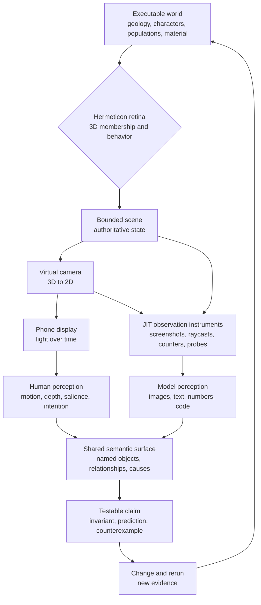

# The Retinae Problem
*An engineering note from Hermeticon Wanderer · October 13, 2026*

**[Enter Hermeticon Wanderer](https://bonoj.github.io/jit/hermeticon-wanderer/?terrain=authored-v1)**

**The problem:** When a world can only be inspected through successive, lossy representations, how do we distinguish a change in the world from a change in the way it was observed?

The answer matters even when the world contains a frightened pumpkin, a shy peacock, and some exceptionally attractive reeds.

## Two ways into one world

The Hermeticon is a three-dimensional aperture onto a persistent geological world. It decides which parts of that world are admitted into its bounded simulation. The virtual camera, by contrast, selects a projection of the admitted world. These are different authorities: **the retina determines membership; the camera determines appearance from an angle.**

Beyond the camera, observation forks. One path leads to a human watching moving pixels. The other can lead to a model receiving screenshots, state reports, source code, or purpose-built measurements. Neither path carries the whole world.



This is not a claim that humans and models perceive alike. They emphatically do not. The human sees an animated peacock open its fan, understands its gesture, and may notice immediately that the motion feels shy rather than mechanical. The model may see isolated frames and descriptions, inspect the fan's opening variable and distance threshold, and infer the gesture's cause. A model can read a formula a human cannot see on the phone; a human can judge continuity, rhythm, and emotional legibility that the formula does not encode.

Both interpretations can refer to **the same peacock, in the same place, responding to the same approach**. That referential and causal agreement is the shared semantic surface. It is not a common internal picture, a common vocabulary alone, or a requirement that one observer imitate the other's senses. It is a world whose meaningful entities and relationships remain stable across radically different observation channels.

## Observation is an engineering interface

A screenshot is a valuable observation, but a screenshot is not an oracle. It collapses depth, time, occlusion, and hidden state into one projection. It can show that reeds *look* absent; it cannot by itself tell whether they are outside the Hermeticon, behind terrain, outside the camera frustum, or incorrectly collapsed.

Different questions require different instruments, selected just in time rather than accumulated into an enormous permanent diagnostics system.

**Rendered observation.** A screenshot or short visual sequence reveals color, silhouette, occlusion, rhythm, and whether a character's action reads at human scale. It is often the best first test of a visual hypothesis. A human can report “those 50 populations are really two shapes in different colors” even when a generator enumerates 50 distinct parameter combinations. The enumeration is true; the perceptual distinction is not.

**Spatial observation.** A CPU raycast against scene geometry can answer whether a line of sight hits a wall, terrain, or a character, and at what distance. When the rendered scene itself matters, a GPU-derived depth or picking pass, or a GPU-side ray query where the rendering implementation supports it, can probe what a particular pixel or ray actually intersects. These are different techniques, not interchangeable magic. A raycast tests geometry and a specified ray; a depth readback tests a rendered view under its depth and rendering rules. Neither automatically explains why a behavior occurred. A GPU raycast is a possible JIT instrument, not a claim that Wanderer currently uses one.

**State observation.** A tiny report can expose character coordinates, Hermeticon-relative distance, current behavior mode, growth fraction, elapsed simulation time, and whether an entity is paused. Such a report can prove that a character's clock did not advance while it was outside the boundary—something an attractive screenshot cannot establish.

**Accounting observation.** Sometimes the correct instrument is arithmetic. If a pumpkin splats into 100 red material beads, count the beads and track their ownership. For material transport, compare quantities before and after the operation; identify transfers, spawns, losses, and conservation errors. Counting answers a question that neither pixels nor raycasts can reliably answer at scale.

**Provenance observation.** The eight-character source SHA in the HUD identifies which code the viewer is supposed to be running; the full SHA remains available for inspection. A source commit, a published mirror, a completed Pages deployment, and observed runtime behavior are distinct facts. Build identity prevents a correct diagnosis of the wrong build, but cannot substitute for an experiment.

An instrument should report the smallest sufficient evidence for the question. If the question is “Does the peacock look alive?”, numerical state is insufficient. If it is “Did the peacock's clock advance outside the rim?”, a screenshot is insufficient. If it is “Did we conserve material?”, counting is stronger than either.

## The meeting point: a falsifiable meaning

Take a single claim: **the reeds belong to the Hermeticon, not to the camera.**

A human rotates the phone's view and expects the reedbed to remain the same population. A model inspects the growth rule, notices a camera-frustum dependency, and proposes a correction. Then the world is rerun. A screenshot sequence can reveal unwanted regrowth; a state probe can compare stem growth before and after a full orbit. If the values remain stable and the view remains coherent, both observers have evidence for the same claim, obtained differently.

That cycle matters more than which observer is “right.” Source reveals mechanisms but can mislead when runtime behavior differs. Visual judgment reveals failures but can misattribute their causes. Instruments connect the two. The shared semantic surface is therefore **executable, inspectable, and revisable**: a set of world entities and causal relationships that can be pointed to, perturbed, measured, and discussed without requiring identical perception.

## The bug was a category error

In the Mists, bead-lattice reeds grow from geological roots as their locations enter the Hermeticon. They retreat at its inner rim. A character approaching them can cause a local collapse and subsequent regrowth.

A camera orbit should change none of those facts. Yet one implementation included the camera's projected frustum in the reeds' growth target:

```js
// Wrong ownership: a camera angle changes biological state.
target = inCameraView && insideRim && !occupied ? growth : 0;
```

Turning the camera away therefore became an ecological event. Turn back, and the reeds might grow again. The image looked plausible, but the world's continuity was false.

The correction removes camera visibility from the state transition:

```js
// World-space conditions own growth; the camera only draws.
target = insideRim && !occupied ? growth : 0;
```

The exact implementation also accounts for the gallery's transition state and a graded rim threshold. The principle is the important part: **changing the observer must not change the observed world's rules.**

The peacock and gardener expose the converse. Their behavior should pause when their world-space bodies are outside the inner Hermeticon boundary, irrespective of which way the camera points. The pumpkin exposes a third distinction: it can leave the *geological sheet* by jumping into a hole while remaining inside the *Hermeticon volume*. Geological support and containment are not synonyms.

## What counts as knowing?

A person watching a phone sees a 3D world reconstructed from a 2D display. An engineer inspecting the result may receive a screenshot, a numerical report, a source diff, and a commit identifier at different moments. None is a complete copy of the running world.

So the workflow needs more than persuasive imagery:

1. **State the invariant.** A 360° camera orbit must not alter population growth or character clocks.
2. **Identify the authority.** World coordinates and the Hermeticon's inner boundary decide membership; camera projection decides pixels.
3. **Make the observation falsifiable.** Orbit without moving the Hermeticon; compare population state before and after, not merely two attractive screenshots.
4. **Keep provenance.** Associate observations with the exact executable build. An eight-character SHA in the HUD is a handle, not a substitute for the full commit or the test.
5. **Preserve uncertainty.** A committed fix, a queued deployment, and a verified running behavior are three different claims.

This is why the small instrumentation details matter. FPS measures performance, not correctness. A build SHA anchors which code was examined. A screenshot supplies visual evidence. A state probe can answer questions pixels cannot. Together they make a partial observation actionable.

## The silly, serious conclusion

The Hermeticon is a three-dimensional retina through which a world is sampled. The virtual camera makes a two-dimensional projection. The phone illuminates two biological retinae. A further observer may encounter only intermittent images and reports encoded into high-dimensional representations.

Somewhere along that chain, a cluster of colored beads becomes a reedbed, a turquoise cube becomes a bashful peacock, and an orange cube becomes a pumpkin with terrible judgment.

But the engineering rule survives every projection:

> **A change in viewpoint must not become a change in reality.**

The next time the reeds grow, we should know what caused them to grow—not merely that someone happened to look.
