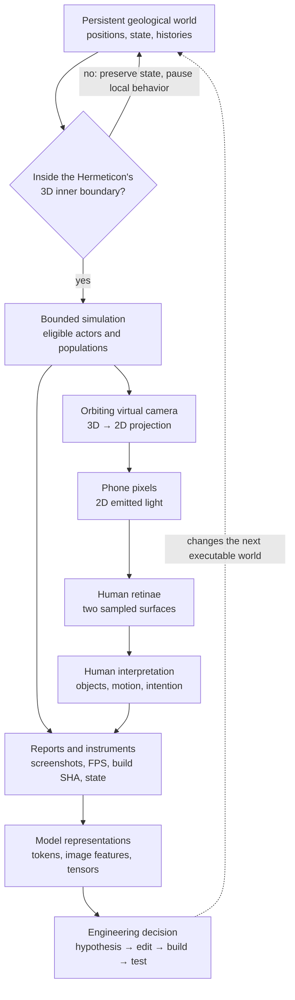

# The Retinae Problem
*An engineering note from Hermeticon Wanderer · October 13, 2026*

**[Enter Hermeticon Wanderer](https://bonoj.github.io/jit/hermeticon-wanderer/?terrain=authored-v1)**

**The problem:** When a world can only be inspected through successive, lossy representations, how do we distinguish a change in the world from a change in the way it was observed?

The answer matters even when the world contains a frightened pumpkin, a shy peacock, and some exceptionally attractive reeds.

## A chain of retinae



Each arrow is a transformation. Each transformation discards something. The pixels cannot tell us whether an invisible peacock is absent, occluded, or outside the Hermeticon. A screenshot cannot establish that a population remained stable through an entire orbit. A build label tells us which source was published, not whether its behavior is correct.

That is the Retinae Problem: **a projection is evidence about a system, not the system itself.**

## The bug was a category error

In the Mists, bead-lattice reeds grow from geological roots as their locations enter the Hermeticon. They retreat at its inner rim. A character approaching them can cause a local collapse and subsequent regrowth.

A camera orbit should change none of those facts. Yet one implementation included the camera's projected frustum in the reeds' growth target:

```js
// Wrong ownership: a camera angle changes biological state.
target = inCameraView && insideRim && !occupied ? growth : 0;
```

Turning the camera away therefore became an ecological event. Turn back, and the reeds might grow again. The image looked plausible, but the world's continuity was false.

The correction removes camera visibility from the state transition:

```js
// World-space conditions own growth; the camera only draws.
target = insideRim && !occupied ? growth : 0;
```

The exact implementation also accounts for the gallery's transition state and a graded rim threshold. The principle is the important part: **changing the observer must not change the observed world's rules.**

The peacock and gardener expose the converse. Their behavior should pause when their world-space bodies are outside the inner Hermeticon boundary, irrespective of which way the camera points. The pumpkin exposes a third distinction: it can leave the *geological sheet* by jumping into a hole while remaining inside the *Hermeticon volume*. Geological support and containment are not synonyms.

## What counts as knowing?

A person watching a phone sees a 3D world reconstructed from a 2D display. An engineer inspecting the result may receive a screenshot, a numerical report, a source diff, and a commit identifier at different moments. None is a complete copy of the running world.

So the workflow needs more than persuasive imagery:

1. **State the invariant.** A 360° camera orbit must not alter population growth or character clocks.
2. **Identify the authority.** World coordinates and the Hermeticon's inner boundary decide membership; camera projection decides pixels.
3. **Make the observation falsifiable.** Orbit without moving the Hermeticon; compare population state before and after, not merely two attractive screenshots.
4. **Keep provenance.** Associate observations with the exact executable build. An eight-character SHA in the HUD is a handle, not a substitute for the full commit or the test.
5. **Preserve uncertainty.** A committed fix, a queued deployment, and a verified running behavior are three different claims.

This is why the small instrumentation details matter. FPS measures performance, not correctness. A build SHA anchors which code was examined. A screenshot supplies visual evidence. A state probe can answer questions pixels cannot. Together they make a partial observation actionable.

## The silly, serious conclusion

The Hermeticon is a three-dimensional retina through which a world is sampled. The virtual camera makes a two-dimensional projection. The phone illuminates two biological retinae. A further observer may encounter only intermittent images and reports encoded into high-dimensional representations.

Somewhere along that chain, a cluster of colored beads becomes a reedbed, a turquoise cube becomes a bashful peacock, and an orange cube becomes a pumpkin with terrible judgment.

But the engineering rule survives every projection:

> **A change in viewpoint must not become a change in reality.**

The next time the reeds grow, we should know what caused them to grow—not merely that someone happened to look.
