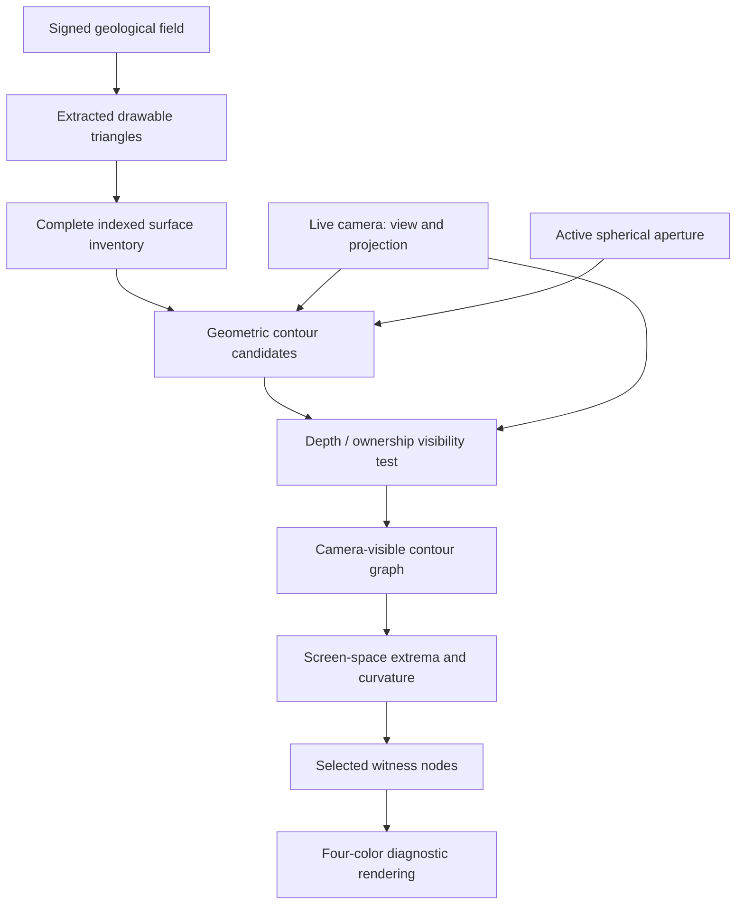
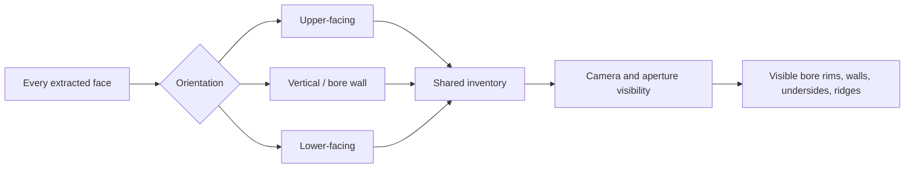
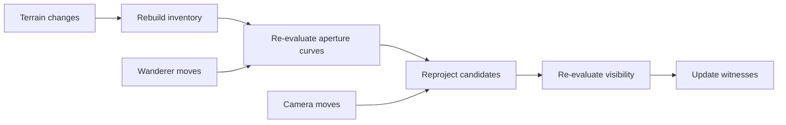

# Hermeticon — Camera-Conditioned Draw Witnesses
*October 14, 2026 · primary conversation record*

This note preserves the human's instruction verbatim and the model's technical response in its original wording and sequence. Interactive chat presentation elements (cards, SVG illustrations, and layout wrappers) are represented by accompanying diagrams rather than copied as UI markup.

## Human — verbatim

> Alright. Take a good long turn to reason in depth about this camera behavior we want and plan your instrumentation and representation. We want to and can afford to capture all the necessary vertices to do this elegantly, including on the vertical edges of voids left by boreholes.

## Model — response transcript

### Hermeticon: the camera as a geometric instrument

I think we can do something more elegant than detecting bright or dark pixels, and more useful than chasing the highest projected vertex.

**Capture the complete drawable geometry, then let the camera decide which parts deserve witnesses.**

That includes the upper surface, underside, bore walls, aperture intersections, and every triangle edge that contributes to a visible boundary.

The distinction I want to preserve is this:

- **The world owns geometry.** We don't invent new geological surfaces.
- **The camera owns visibility.** It decides which geometry participates in the current image.
- **The witness system owns representation.** It selects, organizes, and displays evidence of what the camera sees.

We can afford a generous geometric inventory because it is built when the terrain changes. We should not confuse that with the much smaller amount of work necessary when the camera moves.

The target isn't merely to put a bead on each hilltop. It's to make the visible structure of Hermeticon legible, including the holes punched *through* its world.

### 1. What I found in the current implementation

The source confirms something encouraging: we already have most of the geometric information we need. We're discarding it prematurely.

The marching-tetrahedra extractor produces approximately 119,000 triangles, but `buildHeightIndex()` reduces them to points that pass a vertical signed-field test:

```js
const isTop = below > 0 && above <= 0;
const isBottom = below <= 0 && above > 0;

if (!isTop && !isBottom) continue;
```

**That's where our bore walls disappear.**

A near-vertical wall generally doesn't change its signed-field classification when sampled slightly above and below. It can be perfectly visible, occupy hundreds of pixels, and still fail both tests.

This is not a GPU limitation. It's our classification filter.

We also discard triangle connectivity. We retain positions, but not which vertices form faces or which faces share edges. That connectivity is precisely what makes silhouette detection tractable.

One more useful observation: the shader clips fragments against a sphere, while the CPU selection currently rejects vertices outside that sphere. Those operations are not equivalent. A triangle with all three vertices outside the sphere can still intersect it and contribute visible fragments.

So I would retire the height index as the primary representation. Keep the signed-field tests as optional geological annotations.

### 2. Capture a complete drawable surface inventory

I propose a reusable module, provisionally `arcana/draw-surface.js`.

It would consume the actual extracted terrain geometry, not regenerate terrain from the signed field.

**Drawable surface inventory — built on terrain changes, independent of camera**

- Vertices — All unique positions
- Triangles — Indexed faces
- Edges — Face adjacency
- Normals — Geometric orientation
- Provenance — Original chunk and face
- Bounds — Spatial acceleration

The important design choice is that **every extracted vertex survives**, including vertices on bore walls, undersides, overhangs, and the outer terrain.

We should preserve face indices, not just positions.

The inventory would contain something like:

```js
{
  positions: Float32Array,
  triangles: Uint32Array,
  edges: Uint32Array,
  adjacentFaces: Int32Array,
  faceNormals: Float32Array,
  sourceChunk: Uint16Array
}
```

This isn't a second terrain authority. It's an indexed representation of the mesh we already render.

#### Don't classify by height

Instead, derive optional surface orientation from geometric normals.

A face with an upward normal might be an upper surface; a downward normal might be an underside; a nearly horizontal normal might be a bore wall.

But those are descriptive categories, not selection filters.

A bore wall can be the most important visible feature in the image.

Also, marching tetrahedra currently produces nonindexed triangle buffers, and normals are calculated on those buffers. We can weld coincident positions for adjacency, using a tolerance appropriate to the extraction precision, while retaining original face provenance.

Welding needs instrumentation: nonmanifold edges, unmatched chunk seams, degenerate faces, and inconsistent winding must be counted, not silently ignored.

### 3. The actual camera problem

There are three geometrically different reasons an edge appears in an image.

**Occluding silhouettes**

The outline of a mountain, the lip of a borehole, or a wall seen against the background. A triangle becomes an apparent contour when its surface turns away from the camera, or when it meets another visibility boundary.

**Aperture intersections**

The spherical shader clipping boundary cuts through triangles. These intersections create visible edges that aren't necessarily present in the original vertex set.

**Internal visibility boundaries**

Borehole lips, inner walls, and portions of the underside visible through openings. Some edges separate two visible surfaces rather than separating terrain from background.

This third category is why a simple silhouette mask won't be sufficient.

A binary terrain/background image can detect the outer contour, but not necessarily the rim of a hole when a wall or the underside fills the pixels behind it.

We need visibility information that distinguishes frontmost surface ownership.

### 4. My preferred architecture: geometric candidates, rasterized visibility

I would use a hybrid approach.

Not because we're forced to, but because the CPU and GPU are good at different parts of this problem.

**CPU: identify every place where a visible boundary could exist.**

**GPU: establish which candidates actually survive rendering.**

The CPU side can cheaply identify:

- Shared edges between triangles with different camera-facing orientations.
- Open mesh boundaries and nonmanifold edges.
- Intersections between triangles and the spherical clipping boundary.
- Candidate contours along bore walls and rims.
- Screen-space extrema along projected candidate segments, including interpolated points.

For each triangle with normal \(n\), the camera-facing relationship is approximately:

\[
f = n \cdot (C-P)
\]

where \(C\) is camera position and \(P\) is a point on the triangle.

For a shared edge, a sign change in facing classification between adjacent triangles makes that edge a silhouette candidate.

This is especially natural for our low-poly world.

However, there are two caveats.

First, for perspective projection, the exact smooth apparent contour isn't necessarily identical to an entire shared mesh edge. On a polygonal mesh, the shared edge is a useful candidate; its visible portions still require testing.

Second, camera-facing classification alone doesn't establish visibility. A bore wall may be facing the camera but completely hidden behind the near lip.

That's where the GPU helps.

#### Visibility should be sampled, not guessed

A small auxiliary render pass can provide depth and surface identifiers. The candidate geometry is then projected into screen coordinates and checked against the rendered visibility.

We need to decide whether GPU readback is worthwhile on the target Android browser. I wouldn't make readback a mandatory per-frame operation without measuring it.

An alternative is to render the witnesses or candidate edges with depth testing and let the GPU reject occluded fragments. That can solve the visual problem without returning visibility data to JavaScript, although it makes CPU-side auditing and exact node placement harder.

My preference is to prototype both paths with identical input geometry and compare cost and correctness.

### 5. The spherical aperture deserves special treatment

This is the subtle geometric part.

The shader currently performs a radial test:

```glsl
if (dot(vAperturePosition, vAperturePosition)
    > apertureRadius * apertureRadius)
  discard;
```

A triangle can be cut by that sphere even if none of its original vertices lie exactly on the boundary.

We can calculate its intersections analytically rather than searching arbitrary height samples.

For a triangle edge from \(A\) to \(B\), define:

\[
P(t)=A+t(B-A),\quad 0\le t\le1
\]

The spherical boundary satisfies:

\[
\lVert P(t)-O\rVert^2=R^2
\]

where \(O\) is the aperture center in the relevant coordinate space.

That's a quadratic equation in \(t\).

Its roots give exact line-segment/sphere intersections, subject to numerical precision.

But there's a trap: **the complete intersection of a triangle and sphere can be a curved arc inside the triangle**, not just a straight segment connecting edge crossings. An edge with both endpoints outside the sphere can also pass through it.

Therefore, the intersection representation needs adaptive subdivision or an analytic curve treatment, with screen-space error as its stopping criterion.

We should not generate a second geological wall at the aperture. We only need the curve where existing drawable triangles meet the clip sphere.

And we must use the actual active aperture radius, currently 9.92 in shader-only mode, not the stale 9.72 in `edgeGeometry`.

### 6. What happens to our four arrays?

I would keep four colored populations, but stop pretending they are all vertical geological layers.

The original four arrays helped us discover the problem. They don't have to dictate the solution.

Here's a proposed camera-oriented interpretation:

- **Green — Visible upper contours:** Ridges and crests of upper-facing terrain, selected from what survives the camera projection.
- **Cyan — Aperture intersections:** Points where the drawable surface meets the spherical clipping boundary.
- **Purple — Bore and internal contours:** Hole rims, exposed walls, and internal boundaries revealed by the camera.
- **Red — Visible underside contours:** Underside silhouettes and lower-facing boundaries.

These categories can overlap. A bore rim might also be an aperture intersection. So the underlying representation should allow multiple tags per candidate, even if the display chooses one dominant color.

I would also distinguish **candidate points** from **witness points**.

We can retain thousands of candidate vertices and segments without rendering thousands of beads. A camera-conditioned selection pass chooses a smaller set for legibility.

This is how we get complete geometric evidence without creating a Christmas tree.

### 7. Representation: edges first, nodes second

Here's the most important architectural refinement I would make.

**A node cloud is a poor primary representation of a contour. A contour graph is better.**

Instead of selecting 96 unrelated points and hoping they collectively describe the draw edge, build a graph of visible contour segments, then place nodes along that graph.

Each visible contour component should have:

- Ordered points and connected segments.
- World positions and projected screen positions.
- Source triangle or intersection provenance.
- Depth and visibility confidence.
- Surface-category tags.
- Screen-space arc length and curvature.
- Local maxima and minima in screen coordinates.

The node allocator can then guarantee one or more witnesses per meaningful visible contour component before spending the remaining budget on detail.

A tiny bore rim shouldn't disappear because a large mountain consumed the entire node budget.

Nor should a single ridge receive dozens of nearly coincident witnesses just because it is tall.

### 8. Instrumentation: prove the drawn edges are covered

The 👁 report should answer five questions without requiring us to infer success from a screenshot.

| Measurement | What it tells us |
|---|---|
| `sourceVertices`, `sourceTriangles` | Did we capture the full rendered mesh? |
| `weldedEdges`, `openEdges`, `nonmanifoldEdges` | Is the contour topology usable? |
| `apertureIntersections` | Did we account for shader clipping? |
| `candidateSegments` | How much possible contour geometry exists? |
| `visibleSegments`, `occludedSegments` | What survives the camera? |
| `visibleComponents` | How many independent contours need representation? |
| `boreWallCandidates`, `visibleBoreWallSegments` | Are we actually retaining bore walls? |
| `missedExtrema` | Are visible local high/low points represented? |
| `edgeCoverageP95Px` | How far are visible edges from their nearest witness? |
| `selectionMs`, `visibilityMs`, `readbackMs` | Where is the time going? |
| `cameraRebuilds`, `terrainRebuilds` | Are we doing unnecessary work? |

Crucially, `edgeCoverageP95Px` should be computed against an independently produced visibility reference, not just the selected candidate set.

I'd retain a diagnostic overlay that can show all candidate edges, only confirmed visible edges, and selected witnesses. These are views of the same representation, not separately maintained worlds.

#### A small diagnostic report

```json
{
  "drawWitness": {
    "authority": "camera-visible rasterization",
    "source": "extracted terrain triangles",
    "allSurfaceOrientationsIncluded": true,
    "apertureClippingAccountedFor": null,
    "boreWallVisibilityAudited": false,
    "candidateSegments": null,
    "visibleSegments": null,
    "visibleComponents": null,
    "missedExtrema": null,
    "edgeCoverageP95Px": null,
    "cameraSelectionMs": null,
    "visibilityMs": null,
    "auditPass": null
  }
}
```

Those nulls are intentional. They mean **not yet measured**, not zero.

I would resist adding `auditPass: true` until we have a genuinely independent reference.

### 9. Update strategy and performance

Our current implementation rebuilds the four populations when the Wanderer moves more than 0.24 world units. It doesn't select witnesses based on camera rotation.

That needs to change.

I'd use three distinct invalidation boundaries:

| Event | Recompute |
|---|---|
| Terrain deformation | Surface inventory and affected adjacency |
| Wanderer / aperture movement | Aperture intersections and camera-visible candidates |
| Camera rotation, zoom, or projection change | Projected contours, visibility, witness placement |

We shouldn't reconstruct 119,000 triangles merely because someone rotates their phone or drags the camera.

The world-space indexed mesh remains available. The camera-conditioned work should use it.

For mobile performance, I would begin with a reduced-resolution visibility pass, perhaps half or quarter resolution, and report the corresponding screen-space error. That is a starting experiment, not an assumed sufficient resolution.

A stable camera can permit a more detailed pass. During movement, we can prioritize responsiveness, and refine when motion stops.

But I would **not** introduce that complexity before profiling a straightforward implementation. We've already learned how much engineering can be wasted anticipating performance problems we don't actually have.

### 10. The experiment I would build first

I would not replace the four arrays immediately.

I would introduce a parallel, non-authoritative **Draw Witness** diagnostic and prove the representation in the stationary fixture.

1. **Capture every extracted triangle.** Weld vertices, build adjacency, and report the complete mesh inventory. Verify that bore walls survive.
2. **Project against the live camera.** Compute screen coordinates and facing classifications, and identify potential contours without any height ranking.
3. **Account for the aperture.** Derive clipped contour candidates using the active spherical radius and correct terrain offset.
4. **Validate visibility.** Compare candidate contours against actual rendered depth and ownership. Test whether a bore lip hides its rear wall correctly.
5. **Build the contour graph.** Allocate witnesses to visible components, local screen-space extrema, and bends. Measure coverage.
6. **Rotate the camera.** Confirm that witnesses reorganize while the geological inventory remains unchanged.

The test fixture already contains six bores and eleven relief operations. That's a good starting point. We should also exercise a view where a bore is partly occluded by its own near wall and another where the underside is visible through it.

No deployment is needed for the first architectural step; we can construct and inspect the inventory independently.

### The design principle I'd carry forward

Our earlier work was organized around *which vertices deserve to be selected*.

I now think the correct abstraction is **a camera-conditioned contour graph derived from complete drawable geometry**.

That gives us three layers with clean responsibilities:

**Geometry inventory** — Everything the world could draw.

**Camera-visible contour graph** — Everything the observer can actually see.

**Witness representation** — Everything worth showing or inspecting.

And this is where I think your insistence on capturing *all* the necessary vertices pays off.

We don't need to economize on our understanding of the world. We only need to economize on how much of that understanding we draw at once.

**Capture generously. Observe precisely. Represent selectively.**

That's the architecture I'd put beneath Hermeticon's next experiment.

---

## Graphs and diagrams accompanying the transcript

### Authorities and data flow



### Boreholes: no vertex is discarded for being vertical



### Invalidation graph



**Status:** this is an architectural proposal, not an implementation or performance claim. The transcript's code snippets and measurements refer to the verified earlier Hermeticon source and runtime reports.
