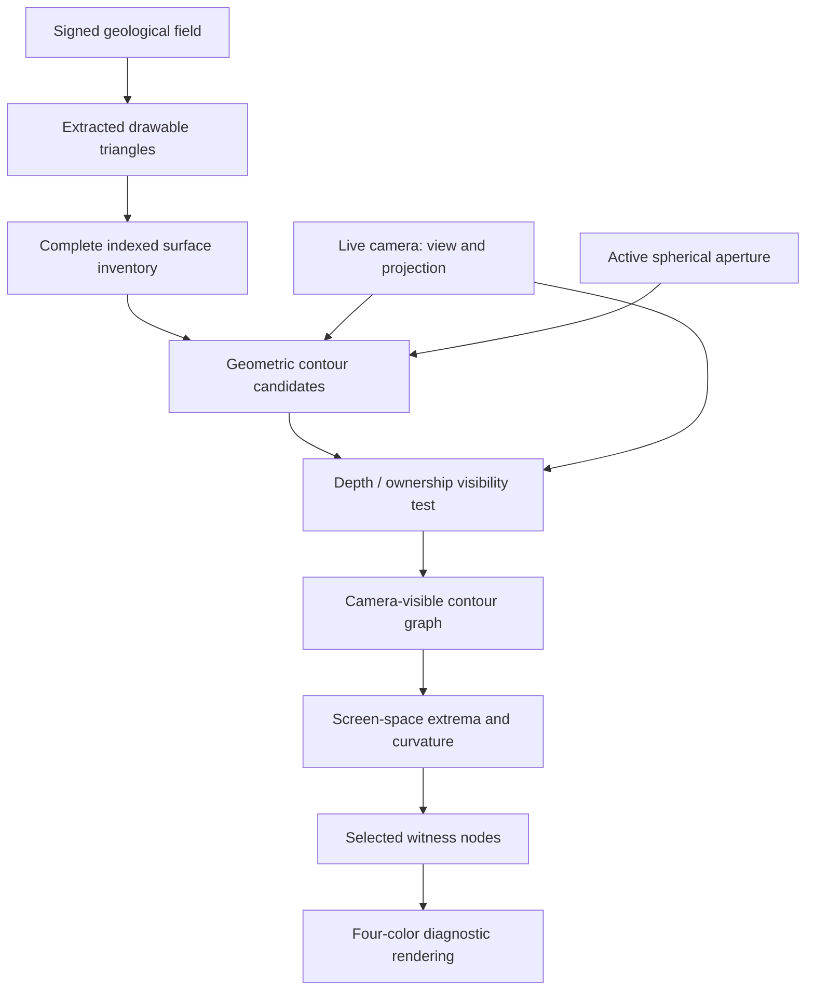
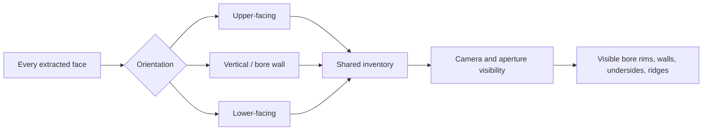
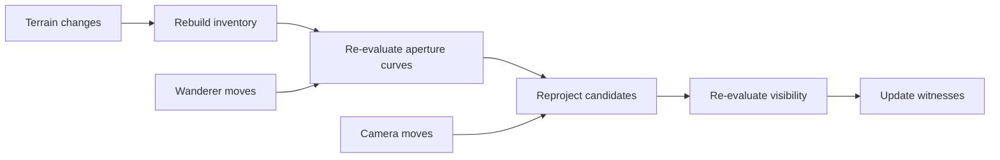

# Filavandrel at the Edge of the World
*Hermeticon · an engineering crossing · October 14, 2026*

**[Enter Hermeticon](https://bonoj.github.io/Hermeticon/)**

> “This game does not exist.”
>
> After the customary qualifications, we agreed to build it anyway.

## The boundary that would not be disguised

Hermeticon is a spherical window into a mutable signed-volume geological world. The terrain is not a sheet with decorative depth: a positive signed field describes solid material; zero crossings describe surfaces; vertical bores pierce the slab, relief changes upper and lower faces independently, and a Wanderer moves over it. A sphere of radius 10.25 encloses a glass interior radius 10.07; the terrain shader currently clips against a spherical aperture radius 9.92. Terrain geometry is extracted from an 85 × 21 × 85 field using marching tetrahedra, in 81 chunks.

The equatorial cutaway was stubborn. We tried ten treatments: geological curtain, pin toy, twin waterfalls, equifog, brass occlusion, curtain/fog and curtain/brass combinations, surface stitching, shader-only transition, and full intersection. None adequately explained the actual geology. A fog spilling over the edge sounded promising, but only if the underlying solid/void structure could be measured cheaply and honestly. The design rule emerged: **do not invent geometry to explain reality; ask the geological field where the geometry belongs.**

An early cylindrical lattice placed 3,744 beads and 7,946 links at arbitrary heights. It ran well but described a cage, not the geological boundary. We removed the links and sampled signed-field zero crossings on the spherical aperture itself. A single instanced brass-bead draw call gave a visible contour. The beads tracked hills and depressions while the Wanderer moved. The experiment succeeded because it separated a *witness* from a *visual treatment*.

## Make the world punch itself

To avoid forcing the human to walk the Wanderer around merely to gather evidence, we authored a stationary stress fixture. It contains through-bores near the aperture, top and bottom relief, and four broad mountains near the rim. All are operations on the same signed field, not visual props. The 👁 inspection report exposes operations, mesh statistics, crossings, interval counts, performance, and build identity. The Wanderer remained at [0,0] throughout the reported tests.

We extracted a pure reusable module, `arcana/boundary.js`: sample a vertical curve against any signed field, bracket and refine sign changes, and return **solid intervals**, including cases where an entire sampled column is solid. A renderer consumes the result; the extractor knows nothing about brass, fog, shaders, or Hermeticon. It is important that topology and appearance have different owners.

The early stationary report at build `8db35c34` found 354 crossings, 177 intervals, 15 wholly void columns, and a 3.6 ms boundary rebuild. Its heuristic labeled all 354 crossings “bore,” an obvious classification bug: sampling horizontally near any surface zero crossing naturally encounters void. This was a diagnostic error, not evidence that every surface was a bore. The mountain build `8281dae3` yielded 119,090 terrain triangles, 348 crossings, 177 intervals, and 3.3 ms boundary extraction; screenshots confirmed the mountains existed and that beads followed a visible dark cutaway crest. Yet a bead chain could miss the apparent localized maximum.

The visual evidence forced a distinction: **the signed-field intersection with the spherical aperture is not necessarily the same as the camera-visible silhouette of terrain farther inside the sphere.** A pale mountain crest and a dark cutaway crest can be two different curves. The rendered marching-tetrahedra approximation may also differ from the continuous interpolated field. A screenshot alone cannot identify which discrepancy is responsible.

## The adaptive probe, and its limits

Build `0fe85128` tested angular subdivision rather than simply doubling all sampling. Starting with 192 angular columns, it examined midpoint crossing topology and curvature, adding samples at suspect locations. It also replaced the misleading bore heuristic with vertical solid-entry/exit labels and corrected the interval-count invariant.

The user-provided report at `0fe85128`:

| Witness | Measurement |
|---|---:|
| Base angular columns | 192 |
| Adaptive columns | 205 |
| Added subdivisions | 13 |
| Signed-field crossings / rendered beads | 369 |
| Vertical exits from solid (“upper”) | 181 |
| Vertical entries into solid (“lower”) | 188 |
| Solid intervals | 188 |
| Entirely void columns | 17 |
| Columns with multiple solid intervals | 0 |
| Interval accounting mismatches | 0 |
| Maximum midpoint excess over endpoints | 0.0229 world units |
| Boundary rebuild | 6.4 ms |
| Added draw calls | 1 |
| Reported instantaneous FPS | 64.51 |

The zero-mismatch check is arithmetic consistency, **not** proof that narrow features or every zero crossing were found. Likewise, “upper” and “lower” are presently *probe direction* labels, not authoritative geological surface identity. There are 181 exits and 188 entries because some sampled solid intervals are truncated by the sampling window; this deserves explicit endpoint accounting. No multi-interval column has yet been exercised in this fixture. The old `edgeGeometry` report still references radius 9.72 and is a stale comparison diagnostic, not the active 9.92 aperture.

The images showed that adaptive beads followed the dark contour better, but did not prove the pale mountain silhouette should match it. Increasing angular density alone cannot answer that question. The next measurement, if needed, compares (1) continuous signed-field crossings, (2) actual triangle/aperture intersections, and (3) camera-visible silhouettes.

## The human's interjection: four arrays

Then came the more important change of representation:

> “4 arrays. Surface terrain nodes, sdf surface nodes just below, sdf undersurface nodes, undersurface terrain nodes.
>
> Surface and undersurface nodes organize by find nearest highest (signed) point whilst maintaining spread. So max ys are always found on surface min ys on undersurface.”

Instead of asking *how many uniformly spaced probes* to use, this asks **where the geometry requires witnesses**.

1. **Surface terrain nodes:** distribute over the upper geological surface and seek local high points, while maintaining coverage and separation. A node's neighborhood or territory prevents every node from collapsing onto the tallest mountain.
2. **Upper SDF nodes:** remain paired with upper terrain witnesses and sample or project toward the corresponding signed-field boundary, potentially slightly inside the solid for stability.
3. **Lower SDF nodes:** provide the analogous signed-field witnesses near the underside.
4. **Undersurface terrain nodes:** distribute over the underside, seeking local minima while maintaining coverage and separation.

This is a *proposal*, not an implemented or verified algorithm. In particular, “nearest highest” and “maintaining spread” need a precise objective and neighborhood rule. A local extremum should not attract every node; coverage must not erase small ridges. Paired SDF nodes should not blindly bridge voids or assume a single top/bottom sheet: bores, overhangs, and disconnected intervals complicate correspondence. Signed-field intervals remain the authority for where solid material actually exists, and adjacency needs explicit topology checks.

The four populations could become a deformable sensor network, using attraction toward meaningful extrema plus repulsion/coverage constraints. Such nodes could serve not just a cutaway treatment, but ridges, basins, excavation previews, near-contact regions, and later material interfaces. A geometry-aware distribution could represent a narrow peak with fewer total witnesses than a uniform angular lattice—**if** its optimization and topology are proven.

## Separation of authorities

There are at least four truths to keep distinct:

- **Geological truth:** signed density, material membership, bores, and solid intervals.
- **Extracted geometric truth:** the marching-tetrahedra triangle approximation and its intersections with the aperture.
- **Observed visual truth:** the projected, shaded, occluded silhouette from a particular camera.
- **Sensor-network truth:** the chosen nodes, their coverage, extrema, pairings, and confidence.

None is automatically interchangeable with another. The four-array idea should connect them deliberately, rather than forcing the field or the camera to pretend they are the same object.

The design constraint remains phone-first and cheap: boundary work occurs on relevant changes, not every frame; diagnostics are just-in-time; a single instanced draw call is preferable to a decorative forest of meshes. The recorded 6.4 ms is a rebuild cost, not a per-frame cost, and must be remeasured if the algorithm changes.

## Next experiments, in order

**First:** make a deterministic node-distribution experiment over the stationary mountain-and-bore fixture. Measure territory coverage, nearest-extremum capture, minimum separation, peak/minimum recall, and stability under small field changes. Show the four node populations in distinguishable diagnostic colors.

**Second:** compare the surface-node maxima and minima with the actual rendered triangle/aperture intersections. Quantify misses instead of relying on the silhouette alone.

**Third:** pair terrain and SDF witnesses only where geological membership supports it. Exercise an authored multi-interval column and a narrow bore; explicitly report invalid pairings and coverage gaps.

**Fourth:** let the boundary network drive an inexpensive visual treatment—perhaps the original darkness flowing over the edge—only after its geometry is trustworthy. Keep the brass witness available for inspection.

The key engineering discovery is not the beads, nor the fog, nor even the four arrays individually. It is the change of question:

> **Not “Where should we sample more densely?” but “Where does the geology demand that a node exist?”**

We came to the edge of the world to disguise it. Instead, we began to learn how to listen to it.

### Commit trail

- `c0900183` — spherical-rim signed-field beads, replacing the arbitrary cage.
- `8db35c34` — stationary punches, reusable interval extractor, corrected deployment after canonical-import validation failure.
- `8281dae3` — four additional rim-facing mountain fixtures.
- `0fe85128` — adaptive angular probes, directional crossing labels, interval instrumentation.

All numbers above are taken from user-supplied runtime 👁 reports, not claimed as exhaustive proof of geometric correctness.


## Addendum — October 14: The terrain already knows

The human and the model tested four colored geological node populations. The initial 96-territory candidate search missed visible crests: its highest node was only the highest of the candidates it happened to sample. A later 768-angle rim survey reported six of six extrema captured and `auditPass: true`, but that audit used the same restricted rim samples as the finder. Screenshots revealed actual terrain peaks between nodes. A passing audit of the wrong domain was not proof of the intended geometry.

The human proposed a simpler representation: sort terrain samples by height while preserving their original indices in a disposable index. Use the top N height indices as starting nodes and binary-search from those seeds to locate boundaries for the surface and subsurface arrays. This is a proposal for the next experiment, not a claim about the current build. Its bracketing, handling of holes and local peaks, and spatial coverage still need measurement.

The crucial pivot was to stop making a separate node-search system rediscover what the terrain already knows. Camera rotation need not invalidate the underlying height ordering; movement through the aperture may require reselection. Measure sort time, selection time, boundary-search time, and mobile frame impact before inventing caching or optimization. In the human's words: "If not, fuck it ;)."

The working principle: **Don't make nodes rediscover what the terrain already knows.** Preserve the earlier failures as evidence of how the human and the model reached this change of representation.

Evidence: colored four-population experiment `747f4aa4`; later metallic-node survey `f5d5f066`, whose narrow audit did not detect the missing full-surface maxima.


## Addendum — October 14: DRAW, not terrain

The four-color node experiment exposed a fundamental category error. We had been finding geological extrema. The human wanted the extrema of **what the camera draws**.

### Failed steps that earned the correction

1. The original angular rim probes missed visible crests despite a passing `auditPass`: the audit covered the probe domain, not the image.
2. A disposable height-ranked mesh index (`845c8d27`, repaired at `4e7573b8`) preserved vertex indices and paired witnesses with vertical SDF bisection. It was efficient but still missed crests. One moved report had 93 upper SDF nodes, three missing crossings, and a suspect Y=3.6 extraction-ceiling seed.
3. Signed-field crossing classification (`c6773e8e`) removed many wall and ceiling candidates:

```js
const below = sample(x, y - .055, z);
const above = sample(x, y + .055, z);
const isTop = below > 0 && above <= 0;
const isBottom = below <= 0 && above > 0;
```

4. The classified candidates were height-sorted, reduced to one extreme per 1.25-unit XZ tile, then to 96 spaced nodes per side. At live build `35534622`, the report showed 57,114 classified vertices, 29,103 upper candidates, 28,011 lower candidates, 210 upper tiles, 208 lower tiles, 96 witnesses in each of four arrays, zero missing SDF crossings, ~55.3 ms one-time index construction, ~3.7 ms selection/search, and four draw calls. `fps: null` was **not** an FPS measurement. `extremaCoverageAudited: false` correctly admitted that visible extrema were untested; zeroed candidate counters were stale instrumentation.
5. A deployment regression was also part of the experiment: `c6773e8e` required `sample` in the module API while the deployed caller did not pass it. The page threw `TypeError: sample is not a function`; the matching `7346ffde` workflow was cancelled, and `35534622` restored a matching, working build. Publish coupled interfaces atomically or compatibly.

We proposed local summit detection. That would have improved a **terrain** question, not the user's question.

> “We want highest point of DRAW not of terrain. I may not have made that clear. We actually give zero fucks about terrain. We need the draw edges.”

A vertex may never appear on screen. The spherical aperture clips triangles *between* vertices; depth testing occludes fragments; camera projection changes apparent height. World-space maximum Y is not a screen-space maximum. The signed field is authoritative for geology, **not** for the visible outline.

The model finally asked whether the desired maximum was the highest visible pixel or the highest clipped 3D point. The human recognized the missing authority:

> “Bam. That's the unlock. Only the camera matters. We got there.”

```text
OLD: field -> mesh -> height sort -> tiles -> nodes -> camera
NEW: field + mesh -> clipping + camera + depth visibility
                  -> drawn edges -> screen-space witnesses
```

**Only the camera matters for this witness-selection question**, not for geological simulation. Camera rotation now legitimately changes the witnesses.

Next experiment, **not yet implemented**: compare a lightweight GPU visibility/depth/ID pass with CPU-projected, clipped geometry; measure screen-edge recall, missed extrema, occlusion, latency, readback stalls, and mobile FPS. Preserve the four colored populations as display infrastructure, but do not assume geological top/bottom pairings map directly to visible edges.

The half-Matrix Larian-facing toy may eventually expose a beautiful low-poly world and its camera-conditioned spatial anatomy together.

The irony: cage, rim probes, adaptive sampling, territories, sorted vertices, signed crossings, tile maxima, bisection, and a deployment failure all led to one corrected noun:

**DRAW.**


---

## BAM. There's the unlock.

The preceding failures culminated in a correction of authority. The model had repeatedly sought higher geological points, then better geological classifications, then more comprehensive geological extrema. The human stopped that search:

> “We want highest point of DRAW not of terrain. I may not have made that clear. We actually give zero fucks about terrain. We need the draw edges.”

And then, when the camera emerged as the missing variable:

> **“Bam. That's the unlock. Only the camera matters. We got there.”**

That is the bridge between the historical crossing and the following engineering specification. The first half records *how we failed to ask the right question*. The second records *what we can build now that we have it*. The camera does not replace the signed field as geological authority; it defines which drawable boundaries matter to the observer. And the boreholes insist that we preserve every face and edge, not merely upward- and downward-facing vertices.

The following instruction and technical response are preserved as the conversation record, with chat-only graphic elements rendered as diagrams.

### Camera-conditioned draw witnesses — conversation transcript
*October 14, 2026 · primary conversation record*

This note preserves the human's instruction verbatim and the model's technical response in its original wording and sequence. Interactive chat presentation elements (cards, SVG illustrations, and layout wrappers) are represented by accompanying diagrams rather than copied as UI markup.

## Human — verbatim

> Alright. Take a good long turn to reason in depth about this camera behavior we want and plan your instrumentation and representation. We want to and can afford to capture all the necessary vertices to do this elegantly, including on the vertical edges of voids left by boreholes.

## Model — response transcript

### Hermeticon: the camera as a geometric instrument

I think we can do something more elegant than detecting bright or dark pixels, and more useful than chasing the highest projected vertex.

**Capture the complete drawable geometry, then let the camera decide which parts deserve witnesses.**

That includes the upper surface, underside, bore walls, aperture intersections, and every triangle edge that contributes to a visible boundary.

The distinction I want to preserve is this:

- **The world owns geometry.** We don't invent new geological surfaces.
- **The camera owns visibility.** It decides which geometry participates in the current image.
- **The witness system owns representation.** It selects, organizes, and displays evidence of what the camera sees.

We can afford a generous geometric inventory because it is built when the terrain changes. We should not confuse that with the much smaller amount of work necessary when the camera moves.

The target isn't merely to put a bead on each hilltop. It's to make the visible structure of Hermeticon legible, including the holes punched *through* its world.

### 1. What I found in the current implementation

The source confirms something encouraging: we already have most of the geometric information we need. We're discarding it prematurely.

The marching-tetrahedra extractor produces approximately 119,000 triangles, but `buildHeightIndex()` reduces them to points that pass a vertical signed-field test:

```js
const isTop = below > 0 && above <= 0;
const isBottom = below <= 0 && above > 0;

if (!isTop && !isBottom) continue;
```

**That's where our bore walls disappear.**

A near-vertical wall generally doesn't change its signed-field classification when sampled slightly above and below. It can be perfectly visible, occupy hundreds of pixels, and still fail both tests.

This is not a GPU limitation. It's our classification filter.

We also discard triangle connectivity. We retain positions, but not which vertices form faces or which faces share edges. That connectivity is precisely what makes silhouette detection tractable.

One more useful observation: the shader clips fragments against a sphere, while the CPU selection currently rejects vertices outside that sphere. Those operations are not equivalent. A triangle with all three vertices outside the sphere can still intersect it and contribute visible fragments.

So I would retire the height index as the primary representation. Keep the signed-field tests as optional geological annotations.

### 2. Capture a complete drawable surface inventory

I propose a reusable module, provisionally `arcana/draw-surface.js`.

It would consume the actual extracted terrain geometry, not regenerate terrain from the signed field.

**Drawable surface inventory — built on terrain changes, independent of camera**

- Vertices — All unique positions
- Triangles — Indexed faces
- Edges — Face adjacency
- Normals — Geometric orientation
- Provenance — Original chunk and face
- Bounds — Spatial acceleration

The important design choice is that **every extracted vertex survives**, including vertices on bore walls, undersides, overhangs, and the outer terrain.

We should preserve face indices, not just positions.

The inventory would contain something like:

```js
{
  positions: Float32Array,
  triangles: Uint32Array,
  edges: Uint32Array,
  adjacentFaces: Int32Array,
  faceNormals: Float32Array,
  sourceChunk: Uint16Array
}
```

This isn't a second terrain authority. It's an indexed representation of the mesh we already render.

#### Don't classify by height

Instead, derive optional surface orientation from geometric normals.

A face with an upward normal might be an upper surface; a downward normal might be an underside; a nearly horizontal normal might be a bore wall.

But those are descriptive categories, not selection filters.

A bore wall can be the most important visible feature in the image.

Also, marching tetrahedra currently produces nonindexed triangle buffers, and normals are calculated on those buffers. We can weld coincident positions for adjacency, using a tolerance appropriate to the extraction precision, while retaining original face provenance.

Welding needs instrumentation: nonmanifold edges, unmatched chunk seams, degenerate faces, and inconsistent winding must be counted, not silently ignored.

### 3. The actual camera problem

There are three geometrically different reasons an edge appears in an image.

**Occluding silhouettes**

The outline of a mountain, the lip of a borehole, or a wall seen against the background. A triangle becomes an apparent contour when its surface turns away from the camera, or when it meets another visibility boundary.

**Aperture intersections**

The spherical shader clipping boundary cuts through triangles. These intersections create visible edges that aren't necessarily present in the original vertex set.

**Internal visibility boundaries**

Borehole lips, inner walls, and portions of the underside visible through openings. Some edges separate two visible surfaces rather than separating terrain from background.

This third category is why a simple silhouette mask won't be sufficient.

A binary terrain/background image can detect the outer contour, but not necessarily the rim of a hole when a wall or the underside fills the pixels behind it.

We need visibility information that distinguishes frontmost surface ownership.

### 4. My preferred architecture: geometric candidates, rasterized visibility

I would use a hybrid approach.

Not because we're forced to, but because the CPU and GPU are good at different parts of this problem.

**CPU: identify every place where a visible boundary could exist.**

**GPU: establish which candidates actually survive rendering.**

The CPU side can cheaply identify:

- Shared edges between triangles with different camera-facing orientations.
- Open mesh boundaries and nonmanifold edges.
- Intersections between triangles and the spherical clipping boundary.
- Candidate contours along bore walls and rims.
- Screen-space extrema along projected candidate segments, including interpolated points.

For each triangle with normal \(n\), the camera-facing relationship is approximately:

\[
f = n \cdot (C-P)
\]

where \(C\) is camera position and \(P\) is a point on the triangle.

For a shared edge, a sign change in facing classification between adjacent triangles makes that edge a silhouette candidate.

This is especially natural for our low-poly world.

However, there are two caveats.

First, for perspective projection, the exact smooth apparent contour isn't necessarily identical to an entire shared mesh edge. On a polygonal mesh, the shared edge is a useful candidate; its visible portions still require testing.

Second, camera-facing classification alone doesn't establish visibility. A bore wall may be facing the camera but completely hidden behind the near lip.

That's where the GPU helps.

#### Visibility should be sampled, not guessed

A small auxiliary render pass can provide depth and surface identifiers. The candidate geometry is then projected into screen coordinates and checked against the rendered visibility.

We need to decide whether GPU readback is worthwhile on the target Android browser. I wouldn't make readback a mandatory per-frame operation without measuring it.

An alternative is to render the witnesses or candidate edges with depth testing and let the GPU reject occluded fragments. That can solve the visual problem without returning visibility data to JavaScript, although it makes CPU-side auditing and exact node placement harder.

My preference is to prototype both paths with identical input geometry and compare cost and correctness.

### 5. The spherical aperture deserves special treatment

This is the subtle geometric part.

The shader currently performs a radial test:

```glsl
if (dot(vAperturePosition, vAperturePosition)
    > apertureRadius * apertureRadius)
  discard;
```

A triangle can be cut by that sphere even if none of its original vertices lie exactly on the boundary.

We can calculate its intersections analytically rather than searching arbitrary height samples.

For a triangle edge from \(A\) to \(B\), define:

\[
P(t)=A+t(B-A),\quad 0\le t\le1
\]

The spherical boundary satisfies:

\[
\lVert P(t)-O\rVert^2=R^2
\]

where \(O\) is the aperture center in the relevant coordinate space.

That's a quadratic equation in \(t\).

Its roots give exact line-segment/sphere intersections, subject to numerical precision.

But there's a trap: **the complete intersection of a triangle and sphere can be a curved arc inside the triangle**, not just a straight segment connecting edge crossings. An edge with both endpoints outside the sphere can also pass through it.

Therefore, the intersection representation needs adaptive subdivision or an analytic curve treatment, with screen-space error as its stopping criterion.

We should not generate a second geological wall at the aperture. We only need the curve where existing drawable triangles meet the clip sphere.

And we must use the actual active aperture radius, currently 9.92 in shader-only mode, not the stale 9.72 in `edgeGeometry`.

### 6. What happens to our four arrays?

I would keep four colored populations, but stop pretending they are all vertical geological layers.

The original four arrays helped us discover the problem. They don't have to dictate the solution.

Here's a proposed camera-oriented interpretation:

- **Green — Visible upper contours:** Ridges and crests of upper-facing terrain, selected from what survives the camera projection.
- **Cyan — Aperture intersections:** Points where the drawable surface meets the spherical clipping boundary.
- **Purple — Bore and internal contours:** Hole rims, exposed walls, and internal boundaries revealed by the camera.
- **Red — Visible underside contours:** Underside silhouettes and lower-facing boundaries.

These categories can overlap. A bore rim might also be an aperture intersection. So the underlying representation should allow multiple tags per candidate, even if the display chooses one dominant color.

I would also distinguish **candidate points** from **witness points**.

We can retain thousands of candidate vertices and segments without rendering thousands of beads. A camera-conditioned selection pass chooses a smaller set for legibility.

This is how we get complete geometric evidence without creating a Christmas tree.

### 7. Representation: edges first, nodes second

Here's the most important architectural refinement I would make.

**A node cloud is a poor primary representation of a contour. A contour graph is better.**

Instead of selecting 96 unrelated points and hoping they collectively describe the draw edge, build a graph of visible contour segments, then place nodes along that graph.

Each visible contour component should have:

- Ordered points and connected segments.
- World positions and projected screen positions.
- Source triangle or intersection provenance.
- Depth and visibility confidence.
- Surface-category tags.
- Screen-space arc length and curvature.
- Local maxima and minima in screen coordinates.

The node allocator can then guarantee one or more witnesses per meaningful visible contour component before spending the remaining budget on detail.

A tiny bore rim shouldn't disappear because a large mountain consumed the entire node budget.

Nor should a single ridge receive dozens of nearly coincident witnesses just because it is tall.

### 8. Instrumentation: prove the drawn edges are covered

The 👁 report should answer five questions without requiring us to infer success from a screenshot.

| Measurement | What it tells us |
|---|---|
| `sourceVertices`, `sourceTriangles` | Did we capture the full rendered mesh? |
| `weldedEdges`, `openEdges`, `nonmanifoldEdges` | Is the contour topology usable? |
| `apertureIntersections` | Did we account for shader clipping? |
| `candidateSegments` | How much possible contour geometry exists? |
| `visibleSegments`, `occludedSegments` | What survives the camera? |
| `visibleComponents` | How many independent contours need representation? |
| `boreWallCandidates`, `visibleBoreWallSegments` | Are we actually retaining bore walls? |
| `missedExtrema` | Are visible local high/low points represented? |
| `edgeCoverageP95Px` | How far are visible edges from their nearest witness? |
| `selectionMs`, `visibilityMs`, `readbackMs` | Where is the time going? |
| `cameraRebuilds`, `terrainRebuilds` | Are we doing unnecessary work? |

Crucially, `edgeCoverageP95Px` should be computed against an independently produced visibility reference, not just the selected candidate set.

I'd retain a diagnostic overlay that can show all candidate edges, only confirmed visible edges, and selected witnesses. These are views of the same representation, not separately maintained worlds.

#### A small diagnostic report

```json
{
  "drawWitness": {
    "authority": "camera-visible rasterization",
    "source": "extracted terrain triangles",
    "allSurfaceOrientationsIncluded": true,
    "apertureClippingAccountedFor": null,
    "boreWallVisibilityAudited": false,
    "candidateSegments": null,
    "visibleSegments": null,
    "visibleComponents": null,
    "missedExtrema": null,
    "edgeCoverageP95Px": null,
    "cameraSelectionMs": null,
    "visibilityMs": null,
    "auditPass": null
  }
}
```

Those nulls are intentional. They mean **not yet measured**, not zero.

I would resist adding `auditPass: true` until we have a genuinely independent reference.

### 9. Update strategy and performance

Our current implementation rebuilds the four populations when the Wanderer moves more than 0.24 world units. It doesn't select witnesses based on camera rotation.

That needs to change.

I'd use three distinct invalidation boundaries:

| Event | Recompute |
|---|---|
| Terrain deformation | Surface inventory and affected adjacency |
| Wanderer / aperture movement | Aperture intersections and camera-visible candidates |
| Camera rotation, zoom, or projection change | Projected contours, visibility, witness placement |

We shouldn't reconstruct 119,000 triangles merely because someone rotates their phone or drags the camera.

The world-space indexed mesh remains available. The camera-conditioned work should use it.

For mobile performance, I would begin with a reduced-resolution visibility pass, perhaps half or quarter resolution, and report the corresponding screen-space error. That is a starting experiment, not an assumed sufficient resolution.

A stable camera can permit a more detailed pass. During movement, we can prioritize responsiveness, and refine when motion stops.

But I would **not** introduce that complexity before profiling a straightforward implementation. We've already learned how much engineering can be wasted anticipating performance problems we don't actually have.

### 10. The experiment I would build first

I would not replace the four arrays immediately.

I would introduce a parallel, non-authoritative **Draw Witness** diagnostic and prove the representation in the stationary fixture.

1. **Capture every extracted triangle.** Weld vertices, build adjacency, and report the complete mesh inventory. Verify that bore walls survive.
2. **Project against the live camera.** Compute screen coordinates and facing classifications, and identify potential contours without any height ranking.
3. **Account for the aperture.** Derive clipped contour candidates using the active spherical radius and correct terrain offset.
4. **Validate visibility.** Compare candidate contours against actual rendered depth and ownership. Test whether a bore lip hides its rear wall correctly.
5. **Build the contour graph.** Allocate witnesses to visible components, local screen-space extrema, and bends. Measure coverage.
6. **Rotate the camera.** Confirm that witnesses reorganize while the geological inventory remains unchanged.

The test fixture already contains six bores and eleven relief operations. That's a good starting point. We should also exercise a view where a bore is partly occluded by its own near wall and another where the underside is visible through it.

No deployment is needed for the first architectural step; we can construct and inspect the inventory independently.

### The design principle I'd carry forward

Our earlier work was organized around *which vertices deserve to be selected*.

I now think the correct abstraction is **a camera-conditioned contour graph derived from complete drawable geometry**.

That gives us three layers with clean responsibilities:

**Geometry inventory** — Everything the world could draw.

**Camera-visible contour graph** — Everything the observer can actually see.

**Witness representation** — Everything worth showing or inspecting.

And this is where I think your insistence on capturing *all* the necessary vertices pays off.

We don't need to economize on our understanding of the world. We only need to economize on how much of that understanding we draw at once.

**Capture generously. Observe precisely. Represent selectively.**

That's the architecture I'd put beneath Hermeticon's next experiment.

---

## Graphs and diagrams accompanying the transcript

### Authorities and data flow



### Boreholes: no vertex is discarded for being vertical



### Invalidation graph



**Status:** this is an architectural proposal, not an implementation or performance claim. The transcript's code snippets and measurements refer to the verified earlier Hermeticon source and runtime reports.


### Implementation after the design discussion

The first non-authoritative implementation was committed to Hermeticon as [`4c193168`](https://github.com/bonoj/Hermeticon/commit/4c193168dad38a1033eacbcc688ad14e62d34914): `arcana/draw-surface.js` inventories extracted faces and welded edges, computes camera-conditioned contour candidates, and exposes `drawWitness` diagnostics. The diagnostic candidate lines remain hidden by default. This is **not yet** verified depth-aware visible-edge extraction or exact spherical intersection curves; the plan's outstanding work remains explicitly outstanding.


---

## The second unlock: the DRAW is the evidence

*Postscript · October 14, 2026 · after implementation and two live witness reports*

The previous sections record a sincere hypothesis: inventory the geometry, ask the camera which edges might matter, then test visibility and distribute witnesses. We built enough of it to learn something important. **That hypothesis was not the final answer.** The following is the later crossing, not an attempt to edit the earlier conversation into having predicted it.

### What actually shipped, and what we saw

[`4c193168`](https://github.com/bonoj/Hermeticon/commit/4c193168dad38a1033eacbcc688ad14e62d34914) introduced the mesh inventory and camera-conditioned edge candidates. The first 👁 report counted **357,270 source vertex occurrences**, **60,213 welded vertices**, **119,090 triangles**, **179,314 edges**, **1,358 open edges**, and **zero nonmanifold edges**. At one viewpoint it generated **9,883 camera candidate segments**, including **2,039 bore-wall candidates**, in **9.4 ms projection time**. The original four geological node populations were still drawn, unchanged. This was instrumentation, not visible witness replacement.

[`292c646a`](https://github.com/bonoj/Hermeticon/commit/292c646ab22a9c7198137f9800954c76b1189a4a) replaced the old node display with camera-conditioned midpoint witnesses and **CPU terrain raycast visibility tests**. Two user-supplied 👁 reports at different azimuths showed ~**9,908–9,933** candidate segments, **140–146 ray tests** per update, **45–47 rejected for occlusion**, **12–18 rejected at the aperture**, and **93–101 displayed witnesses**. Node populations changed as the camera rotated: green 45→33, purple 14→40, red 34→28; cyan remained **zero**. Both reports were around **59 FPS**, but these are isolated snapshots, not controlled before/after benchmarks. The earlier ~88 FPS snapshot came from a different build/view; it does not prove the exact cost of one subsystem.

Crucially, the reports still said `visibilityAudited:false`, `apertureCurveAudited:false`, and `contourCoverageAudited:false`. We had **not** demonstrated that selected nodes traced the boundaries of what the GPU actually rendered.

The human saw the expensive shape of the problem immediately:

> “Camera doesn't need to look everywhere. Just at edge where terrain can exist.”

And then:

> “Terrain does not know what is drawn and what isn't? But we don't want cameras to have to raycast. We need the gpu to tell us exactly what is being drawn.”

Finally, the distinction that corrected the earlier “BAM”:

> “The camera isn't really the unlock. It's just the only view we care about.”

### What changed conceptually

A camera is a **parameter of the view**, not the source of truth for visibility. The GPU already evaluates projected triangles, depth, clipping and fragments. Our CPU reconstruction walked tens of thousands of possible edges and tried to recover facts that the rendering pipeline had already decided.

The desired observable is more modest and more precise: **the boundary of terrain that is actually drawn in the current viewport**. Begin with the circular aperture and visible terrain/empty-space transitions; account for bore openings. A low-resolution terrain-only occupancy mask is a sensible first experiment because it asks about *rendered coverage*, not about all potential mesh edges.

But a binary mask alone is **not sufficient** for every boundary. A bore lip may have visible terrain behind it, so terrain-to-terrain depth or surface-identity discontinuities can matter. The GPU does not magically hand JavaScript a list of 3D edges: an explicit render pass and perhaps costly readback are required, and any sparse world-space witnesses still need depth/unprojection or equivalent verified correspondence.

This is a change of **evidence source**, not an assertion that the next method is already implemented.

### Cleanly putting the experiment away

At [`b1e4e822`](https://github.com/bonoj/Hermeticon/commit/b1e4e82265d2e91ea70dbb343236e1c103b28bd3), we removed both the old height-ranked four-surface selection and the camera mesh-edge/raycast witness machinery from active Genesis. Their commits remain recoverable. In their place is a deliberately **empty**, instrumented `arcana/node-maker.js`: four inherited colors, up to 256 instances per kind, `world.setWitnessNodes([{x,y,z,kind}])`, honest counts and rejection/timing diagnostics. No automatic nodes. No claims of audited edge coverage.

The **terrain and Wanderer remain real, running systems**: an 85×21×85 signed field, 81 extracted chunks, six bores, eleven relief operations, shader-clipped aperture radius 9.92, and a supported tap-to-walk gold cube that moves in geological coordinates while the terrain translates under its viewing sphere. Genesis still performs a **tap-only** mesh raycast for underside interaction ownership; removing CPU raycasts from witness selection did not remove that independent interaction.

The technical state and next experiment were then consolidated into [Hermeticon HANDOFF](https://github.com/bonoj/Hermeticon/blob/main/HANDOFF.md), with README and the preserved legacy Wanderer handoff corrected at [`425c762b`](https://github.com/bonoj/Hermeticon/commit/425c762bca1f89f975be14bda62ca416c6b6900e). The old Wanderer fixture is **not** the authored Genesis currently mounted at the root.

### The next small, falsifiable experiment

1. Render a small **terrain-only occupancy mask** with the **same camera and spherical fragment-discard behavior** as Genesis. Show its boundary over the actual image.
2. Rotate the view and inspect the outer aperture, ridge silhouettes and bore lips. Where occupancy cannot distinguish foreground terrain from background terrain, investigate **depth/surface ownership discontinuities** rather than pretending a mask knows more than it does.
3. Instrument mask resolution, boundary alignment, render time, any GPU readback stalls and phone FPS. Do not move extraction to the CPU without measuring the crossing.
4. **Only after the drawn boundary is proven**, recover world-space positions and feed a sparse set of witnesses into the empty node maker.

No contour graph, geological extrema, camera-wide mesh inventory or new abstraction is prerequisite to step one.

### What Filavandrel learned

The first unlock was **“We want highest point of DRAW, not of terrain.”** It broke our fixation on geological height.

The second unlock was subtler: **we do not need to infer the DRAW from a CPU simulation of the camera. We can ask the renderer what it drew.**

The earlier architecture and Mermaid diagrams above are preserved as historical proposals, **superseded for the immediate experiment**. The later decision is GPU-first visible-boundary evidence, with the smallest possible diagnostic pass. It is not yet a solved boundary extractor.

**The world owns matter. The renderer owns the visible evidence. The witness maker only renders the witnesses we can justify.**
